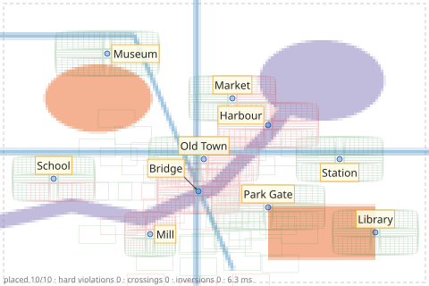

# The debug overlay

The debug overlay is an SVG of what the engine saw and did: the item shapes, the
obstacles, the label boxes and leaders, the omitted items with their reasons and, if
written during the solve, a heatmap per obstacle class and every candidate. Look at it
first when a label goes somewhere unexpected.

This one is from the [classmap example](../tutorials/raster-backgrounds.md#classmap): the
water, parks and roads classes as heatmaps (one colour per class, opacity = the cell's
coverage), the candidates considered (green: statically feasible, red: not) and the placed
labels.

## Getting it

| | During the solve (with heatmaps and candidates) | Afterwards, from a problem and a result |
|---|---|---|
| Problem JSON | `"output": {"debug_svg": true}` → `result.debug_svg` | — |
| CLI | `label-anything place p.json -o r.json --debug-svg overlay.svg` | `label-anything render p.json r.json -o overlay.svg` (or `.png`) |
| Python | `la.place(..., debug_svg=True)`, then `res.to_svg("overlay.svg")` | `res.to_svg(path)`, `la.render_svg(problem, result)` |
| JavaScript | `output.debug_svg`, `result.debug_svg` | `renderDebugSvg(problem, result)` |
| Java | `.debugSvg(true)`, `result.debugSvg()` | `LabelAnything.renderSvg(problem, result)` |
| C | `output.debug_svg` in the problem | `la_render_svg(problem, result, &svg)` |

An overlay rendered afterwards has no heatmaps or candidates, which exist only during the
solve, and does not show raster backgrounds.

## Layers

The overlay has one SVG group per layer, which a viewer or a script can toggle:

| Group id | Content |
|---|---|
| `background`, `label-area` | white background; the label area (canvas or region minus padding), dashed |
| `heatmap-<class>` | the coverage grid of one obstacle class (during the solve only) |
| `obstacles` | vector and SVG obstacle geometry in grey (title: its class) |
| `candidates` | candidate boxes, green when statically feasible, red when not (during the solve only) |
| `items` | item marks in blue, area anchors lighter |
| `leaders` | leaders, underlines and their start points |
| `labels` | label boxes and their text (title: id, side, cost, rank) |
| `unplaced` | a red cross per omitted item (title: reason, blocking classes, blocked by) |
| `stats` | placed / total, hard violations, crossings, inversions, runtime |

In a browser, hover a label box or a cross to see its title. For the numbers behind a
choice, add `"output": {"cost_breakdown": true}` (each label's cost per term) or
`"candidates": true` (every candidate with its cost).
