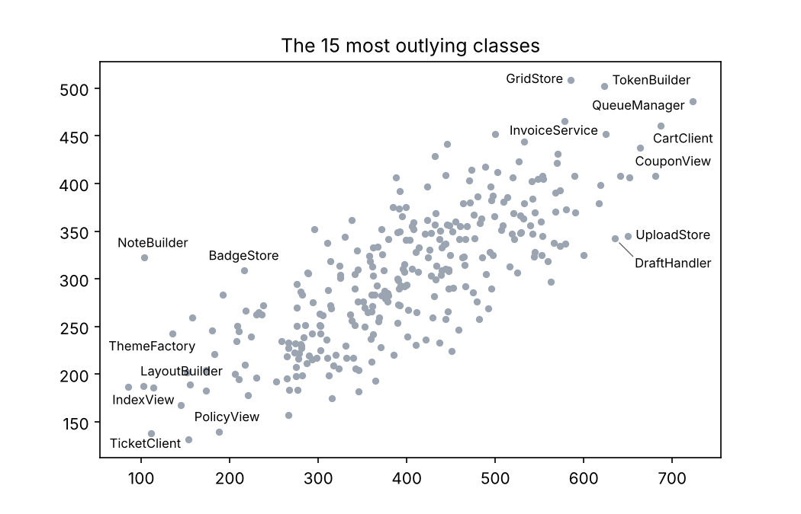

# Python

`label-anything` is the Python binding of the Rust engine: one typed wheel (abi3) for
CPython ≥ 3.9, without dependencies. The optional package `label-anything-extras` adds
plotting helpers for matplotlib, Plotly and seaborn.

## Install

```sh
pip install label-anything                 # the engine
pip install "label-anything[matplotlib]"   # + label_anything.matplotlib (also: plotly, seaborn, all)
```

Neither is on PyPI yet. Until then, build the wheel from a clone of the repository (Rust ≥
1.88 and [maturin](https://www.maturin.rs/)) and install it with the helpers:

```sh
pip install maturin
maturin build --release -m rust/crates/la-py/Cargo.toml
pip install rust/target/wheels/label_anything-*.whl bindings/python-extras
pip install matplotlib plotly seaborn      # the plotting libraries you use
```

## One call

`la.place` takes the anchors and labels, and every option as a keyword:

```python
--8<-- "examples/tutorials/python/basics.py:one-call"
```

Anchors are `(x, y)` pairs, an `(N, 2)` array or a two-column DataFrame; labels are
strings or `la.Text`, `la.Icon`, `la.Box` and `la.Composite` objects. These keywords take
one entry per anchor: `ids`, `attrs` (a list of dicts, a dict of columns or a DataFrame),
`marks`, `required`, `groups`, `keep_with`, `svg_ids`, `item_placement`, and `priority` or
`tiers` as lists of numbers. Attribute values may be NumPy scalars, dates (`datetime`,
`Timestamp`, `datetime64`, passed as ISO 8601 strings, which compare chronologically in
[expressions](../reference/expressions.md)) and durations (as seconds); NaN, `NA` and
`NaT` are dropped.

Every other keyword sets a field of the [problem](../concepts/problem.md). `None` means
"not set", so the [default](../reference/defaults.md) applies.

| Keywords | Problem field |
|---|---|
| `canvas=(w, h)` or a dict; `canvas_padding`, `allow_outside`, `region`, `device_pixel_ratio`, `canvas_background` | `canvas` |
| `y_axis`, `transform`, `preset`, `weights`, `degrade`, `warm_start` (a `Result` works) | the field of that name |
| `font` (`la.Font`), `font_family`, `font_size`, `font_weight`, `font_style`, `line_height`, `font_file` | `defaults.font` |
| `padding`, `buffer`, `margin`, `mark`, `wrap`, `truncate`; `shaping` | `defaults`; `text.shaping` |
| every field of `placement` (`models`, `position_order`, `offset`, `max_distance`, `internal`, `boundary`, `fan`, …) | `placement` |
| `leaders`: a style name or `la.Leaders(style="angles", angles=range(0, 360, 45))` | `leaders` |
| `avoid` (labels, or a dict with `label`, `leader`, `buffer`), `avoid_leader`, `avoid_buffer`, `relaxable` | `avoid` |
| `priority`, `tiers`, `omission`, `coverage`, `ties`, `band`, `focus`, `font_classes`; `max_labels`, `max_ink_fraction` | `priority`; `priority.budget` |
| `strategy`, `time_budget_ms`, `max_iterations`, `seed`, `grid_cell` | `solver` |
| `min_scale`, `wrap_max_lines`, `soft_overlap_weight` | `degrade_options` |
| `debug_svg`, `cost_breakdown`, `candidates`, `item_shape` | `output` |
| `background` and its options ([below](#backgrounds)), `vector=[{"class": …, "points": …}]`, `obstacles` | `obstacles` |
| `defaults`, `text`, `placement`, `solver`, `degrade_options`, `output` | the whole section, merged; the keywords above win |

## The builder

`la.Problem` collects items, backgrounds, obstacles and options step by step. Its
constructor and `set()` take the keywords of `la.place`; `build()` returns the problem as a
dict, `solve()` the result.

```python
--8<-- "examples/tutorials/python/basics.py:builder"
```

`build(embed_background=True)` and `to_json()` embed a NumPy background as base64, which
makes the JSON self-contained, e.g. for the CLI.

## Raw JSON

`la.place_problem` solves a problem from elsewhere — a file, another tool, the
[problem format](../concepts/problem.md) written by hand — given as a dict, JSON text, a
`pathlib.Path` or a `Problem`.

```python
--8<-- "examples/tutorials/python/basics.py:raw"
```

## Results

`Result.placements` holds one frozen `Placement` per item, in input order; `res["id"]`
looks one up (ids are strings: `res[101]` looks up `"101"`).

```python
--8<-- "examples/tutorials/python/basics.py:result"
```

A `Placement` has the fields of the [result format](../concepts/result.md):

* `id`, `placed`, `box` (a `BBox` with `x, y, w, h` in canvas px, y down, and
  `x1, y1, cx, cy`), `anchor`, `anchor_side`, `model`, `leader` (`points`, `style`,
  `port`, `underline`, `curve`), `lines`, `baselines`, `priority`, `degrade_steps`;
* for omitted items: `reason`, `blocking`, `blocked_by`;
* for group labels: `members`, `leaders`; for composite labels: `parts`;
* the JSON object: `raw`.

`Result` also has `placed`, `unplaced`, `omission_order`, `stats`, `warnings`, `to_dict()`
and `to_svg(path=None)`, which draws the debug overlay (with heatmaps if solved with
`debug_svg=True`).

## Errors

An invalid problem raises `la.ValidationError` (a `ValueError`) with one
`{pointer, code, message}` per error; `pointer` is a JSON Pointer into the problem.
[Errors and validation](../concepts/errors.md) lists the codes.

```python
--8<-- "examples/tutorials/python/basics.py:errors"
```

```text
/canvas/width range must be > 0
/defaults/padding unit invalid length "3qq": use a number (px) or <number>px|pt|em
```

## Backgrounds

`background=` takes one background or a list:

| Input | Becomes |
|---|---|
| a `str` or `Path` of a PNG, JPEG or WebP file | a raster source (by its absolute path) |
| a `str` or `Path` of an SVG file | an SVG source |
| `bytes` of an encoded image | a raster source (as a `data:` URL) |
| `str` or `bytes` of SVG markup | an SVG source |
| a NumPy `uint8` array (H × W × 4, × 3 or grey; floats in [0, 1] and bools are converted), a PIL image | pixels, passed to the engine in one copy |

Options: `background_mode` (`ink`, `alpha`, `cost`, `classmap`, `saliency`),
`background_class`, `background_scale`, `background_offset`, `background_options` (merged
into the source, e.g. `{"ink": {"threshold": 0.2}}`), `svg_classes` (`(selector, class)`
pairs, a `{selector: class}` dict or rule objects), `svg_default_class` and
`auto_mark_items`. Without a `canvas`, the canvas is the raster's size divided by its scale,
or the SVG's viewport. `la.capabilities()` lists the image formats this build decodes. See
the tutorials on [raster](../tutorials/raster-backgrounds.md) and
[SVG](../tutorials/svg-background.md) backgrounds.

## Callbacks

`la.place`, `Problem.solve` and `la.place_problem` also take functions, which JSON cannot
hold:

```python
--8<-- "examples/tutorials/python/basics.py:callbacks"
```

* `measure(text, font)` measures text with your own fonts (`font.size` in px). It returns
  a `la.TextMetrics`, `{width, ascent, descent}`, `(w, a, d)`, or `None` to use the bundled
  font; `measure("", font)` asks for the vertical metrics. Results are cached per text and
  font during a solve.
* `cost(candidate)` adds a cost ≥ 0 per candidate (`candidate.id`, `.box`, `.leader`).
* `progress(phase, fraction)` reports `"greedy"`, `"local"` and `"exact"` as they start,
  then `("done", 1.0)`.
* `cancelled` stops the solve early: a `la.CancelToken` (`token.cancel()` from any
  thread), a callable returning `True`, a `threading.Event`, or an object with a
  `cancelled` attribute. A cancelled solve raises `la.Cancelled`.
* `priority=callable(item)` returns a score or `(tier, score)` per item, called once
  before the solve ([a priority function](../tutorials/priority.md#a-priority-function)).

The solve releases the GIL; callbacks reacquire it. An exception in a callback stops the
solve and is re-raised with its traceback, as is Ctrl-C on the main thread.

## Plotting helpers

### matplotlib

`label_points(ax, x, y, labels, **opts)` renders the figure without its texts as the
background, adds its visible texts and legends as hard obstacles, measures the labels with
the figure's renderer, solves, and adds the labels and leaders to the axes. `x` and `y` are
in the units of the plotted data, dates and categories included.

```python
--8<-- "examples/tutorials/python/helpers_matplotlib.py:matplotlib"
```

{ width="560" }

The default [degradation ladder](../concepts/candidates.md#the-degradation-ladder) may
shrink a label that fits nowhere else or relax hard obstacle classes. The example's shorter
ladder does neither: every label keeps its size, and labels that do not fit are omitted.

Call `label_points` when the figure is final: its size and layout (`tight_layout`), axis
scales and limits, colorbars and legends. The labels are in data coordinates, so any
savefig dpi works, but changing the axes' size or scale afterwards moves the points away
from their labels.

With a `priority`, an important label may cover the markers of less important points,
which then stay unlabeled, so that important labels survive in a crowd
([important labels over minor marks](../tutorials/priority.md#important-labels-over-minor-marks));
`avoid={"lower_items": "hard"}` keeps every marker clear.

The helper's own options (all others go to `la.place`):

* `region`: `"axes"` (default) or `"figure"`, to let labels use the figure's margins;
* `background`: `"raster"` (default), `"svg"`, `None`, or any `background=` input of
  `la.place`;
* `fontsize` (points or a size name), `fontfamily`, `fontweight`, `fontstyle`: the label
  font, measured with the figure's renderer (`measure=False`: the bundled font);
* `marker_size` (points², as in `scatter(s=)`; one number or one per point): the markers
  the labels avoid;
* `avoid_texts` (default `True`): make the figure's visible texts hard obstacles;
* `draw` (default `True`): add the artists, or only solve;
* `text_kw`, `leader_kw`: extra properties of the `Text` and `Line2D` artists;
* `preset` (default `"scatter"`).

It returns the `result` and the artists it added (`texts`, `leaders`).

### Plotly

`label_anything.plotly.label_points(fig, x, y, labels, **opts)` adds layout annotations
and leader shapes, computed from the figure size, margins, axis domains and ranges, which
it then fixes. It supports linear and log axes; other scatter traces on the same axes are
obstacles.

```python
--8<-- "examples/tutorials/python/helpers_plotly.py:plotly"
```

Its own options: `xref`/`yref` or `row`/`col`, `font_size` (px), `marker_size` (marker
diameter in px), `avoid_traces`, `add`, `annotation_kw`, `line_kw` and `preset` (default
`"scatter"`).

### seaborn

`label_anything.seaborn.label_points(ax, data=df, x=..., y=..., label=...)` takes column
names, like seaborn's axes-level functions; `priority="pop"` ranks the points by that
column.

```python
--8<-- "examples/tutorials/python/helpers_seaborn.py:seaborn"
```

## Limitations

* The Plotly helper measures text with the bundled font, not the browser's, and assumes
  the figure is shown at the size it sets; legends that widen the margins shift the plot
  area.
* The matplotlib helper draws text labels and the text parts of composites; you draw icons
  and boxes from the result.

The programs on this page are in [`examples/tutorials/python`](gh:examples/tutorials/python)
and run in CI. They read their data (`points.csv`, …) from the working directory: run them
in [`examples/tutorials/data`](gh:examples/tutorials/data), or all at once with
`python3 examples/tutorials/run.py python`.
