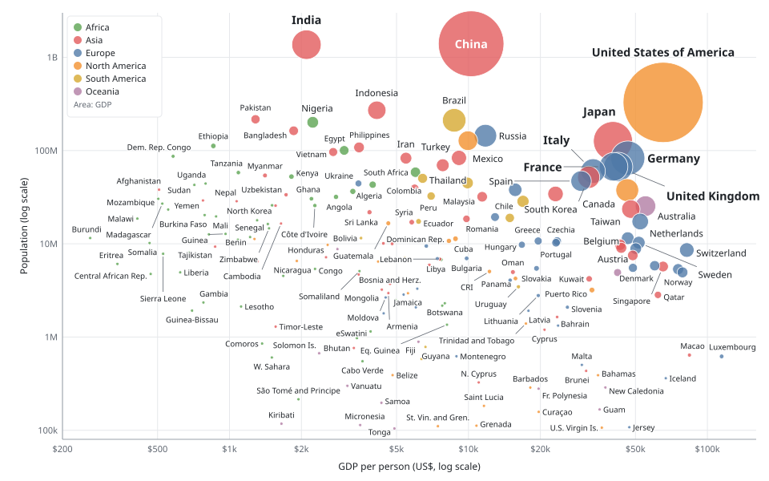
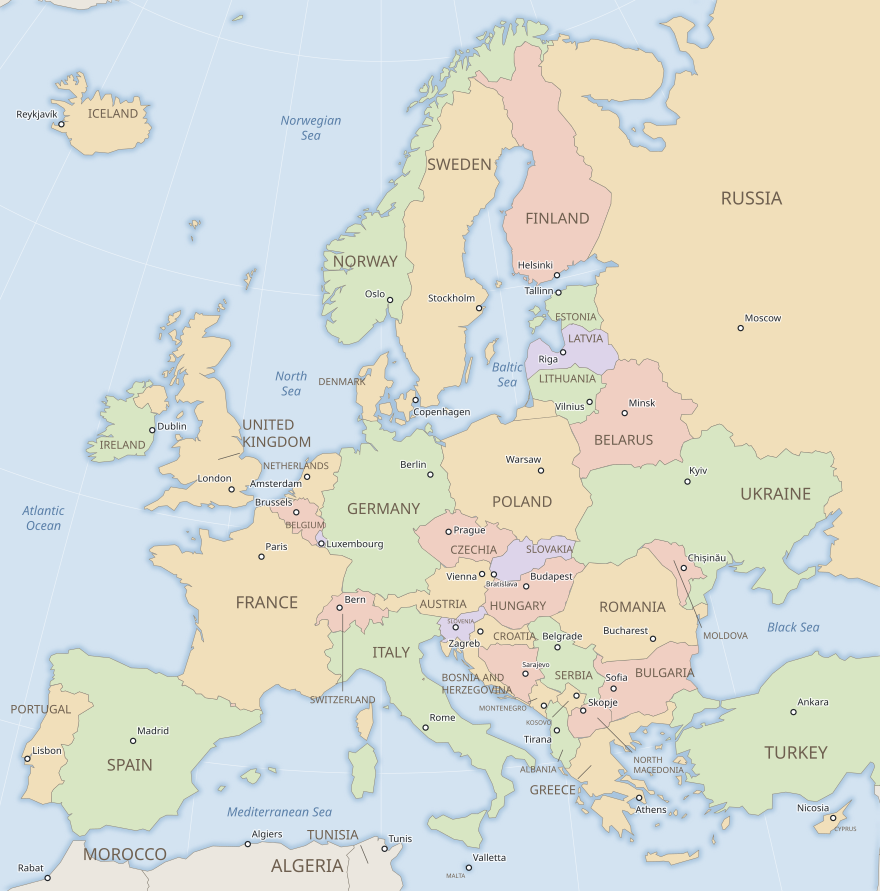
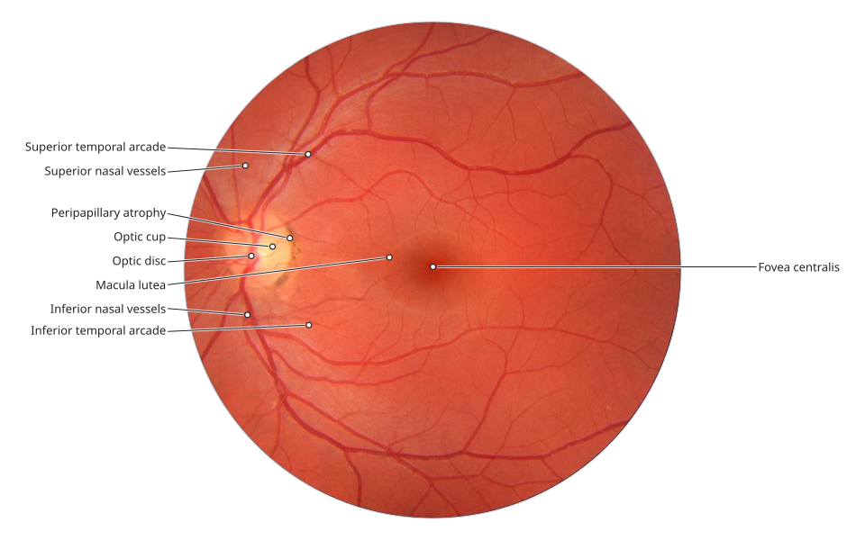
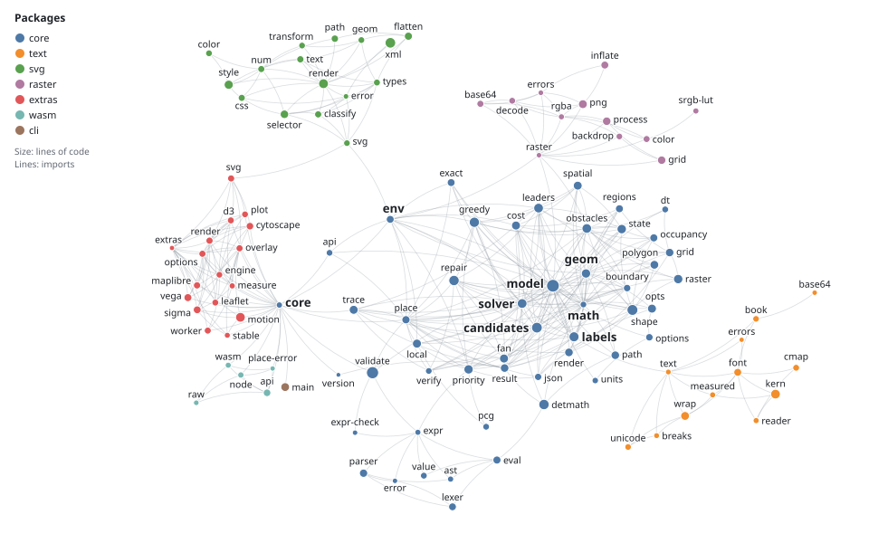

## What it does

<div class="grid cards la-steps" markdown>

-   :material-numeric-1-circle:{ .lg .middle } **You describe**

    ---

    The items to label — points, shapes, areas — with their labels (text, icons, any
    box), and what must stay visible: marks, lines, or the whole chart as SVG or image.

-   :material-numeric-2-circle:{ .lg .middle } **It places**

    ---

    Each label goes beside its item or on a leader line, without overlaps or crossing
    leaders. What does not fit is left out, least important first, with the reason.

-   :material-numeric-3-circle:{ .lg .middle } **You draw**

    ---

    Boxes, leaders and text lines come back as plain coordinates, to draw with
    matplotlib, D3, Canvas, SVG or anything else.

</div>

<figure markdown>
[](assets/figures/economies.svg)
<figcaption>The world's economies: each country a bubble sized by its GDP (Natural Earth,
2019). Label Anything labels 147 of 193 in a fraction of a second.</figcaption>
</figure>

In this chart:

* **On the true shape.** Each label touches its bubble's outline where there is room;
  China's sits inside its bubble.
* **Tight to its letters, apart from each other.** A label's box fits the ink of its text,
  so above or below its bubble a label stands as close as beside it. Labels keep twice as
  much space from each other as from other bubbles, so that two never read as one.
* **Clearly its own.** No label covers another country's bubble, and every label is
  clearly nearer its own bubble than any other: by a margin, or joined to it by a short
  stub at a right angle to the middle of its side (Myanmar, Mozambique, Bhutan).
* **Leaders where it is crowded.** France and the United Kingdom overlap Germany's bubble,
  so their labels sit on leaders that do not cross.
* **Importance decides.** Larger economies are labeled first, the eight largest in larger
  bold type. Of the 46 countries left out, 44 have no room beside the larger economies'
  labels, and the result names the labels in the way; Austria and Hong Kong lie so close
  among others that no place beside them would be clearly theirs.
* **Full names.** Every label is the country's full name, a long one on two centered lines
  (the United States of America); a name that does not fit is left out rather than
  shortened to a code.
* **Graded avoidance over any background.** The chart is an SVG, passed unchanged and
  classified with CSS selectors: labels may cross grid lines but never the axes, their
  text or the legend.

## Why Label Anything

The *anything* is the host and the label: adjustText (matplotlib), ggrepel (ggplot2) and
vega-label (Vega) each serve one plotting library; Label Anything is one engine and one
problem format for any chart, map or diagram, any label with a size and every language.

<div class="grid cards" markdown>

-   :material-shield-check-outline:{ .lg .middle } **Graded avoidance**

    ---

    Each obstacle class is `"hard"`, `"ignore"` or a weight, for labels and leaders
    separately: "never cover outliers, cover other points at a small cost, never cross a
    leader" is one line. [Avoidance](concepts/avoidance.md)

-   :material-sort-variant:{ .lg .middle } **You decide what goes**

    ---

    Priority from data attributes, outlierness, tiers, coverage per category or your own
    function; an omission mode states what the order guarantees.
    [Priority](tutorials/priority.md)

-   :material-shape-outline:{ .lg .middle } **Shape-aware**

    ---

    Circles, ellipses, rotated rectangles, polygons, paths, pins, areas. Large shapes hold
    their labels inside, small ones get them outside or on leaders.
    [Shapes](tutorials/shapes.md)

-   :material-layers-outline:{ .lg .middle } **Any background**

    ---

    Vector shapes, an SVG classified with CSS selectors, or an image read in one of five
    modes (ink, alpha, cost, classmap, saliency).
    [SVG](tutorials/svg-background.md) · [raster](tutorials/raster-backgrounds.md)

-   :material-equal-box:{ .lg .middle } **Deterministic**

    ---

    The same input and seed give the same result on every machine and in every language:
    the time budget is an iteration count, and floating-point work is specified operation
    by operation. [Solver](concepts/solver.md)

-   :material-code-braces:{ .lg .middle } **Every language**

    ---

    A Rust core with Python, Java, C/Go and WebAssembly bindings, a pure TypeScript port,
    a CLI and an HTTP server, all reading one versioned JSON format.
    [Getting started](getting-started/index.md)

</div>

Hundreds of labels take milliseconds, thousands a few hundred milliseconds. When things
move — a dragged node, a panned map — each solve starts from the previous result, so
labels stay put ([interactive maps](tutorials/interactive-maps.md)).

## Gallery

Open data, labeled by the engine
([scripts](gh:examples/showcase/make_showcase.py)); click a picture to enlarge it.

<figure markdown>
[](assets/figures/europe.svg)
<figcaption markdown>**A map.** The countries and capitals of Europe (Natural Earth,
internationally recognized borders). The countries are the picture's
[regions](concepts/regions.md): each name inside its country where it fits, else out on a
leader into the sea (the United Kingdom, the Balkans), never in a neighbouring
country, its type size growing with the country's area; the capitals beside their dots, in
the cartographer's order of positions, all in one size; no label covers the name of a sea.
88 of the 90 labels placed: the name LUXEMBOURG (its capital is labeled) and Podgorica find
no room.</figcaption>
</figure>

<figure markdown>
[](assets/figures/retina.svg)
<figcaption markdown>**A photograph.** The back of an eye (fundus photograph by
M. Häggström, CC0), labeled like an anatomy atlas: names in the margins, each with a leader
to its part.</figcaption>
</figure>

<figure markdown>
[](assets/figures/modules.svg)
<figcaption markdown>**A diagram.** This library's own TypeScript modules: 112 nodes, 416
imports. The most imported are labeled first, in bold; labels may cross edges at a cost,
never nodes, and a label that would stand as near another node as its own goes out on a
leader. All 112 placed.</figcaption>
</figure>

## Five lines

The outliers of a scatter plot, labeled from every language. The chart is an image
(`scatter.png`); `outliers.csv` lists the points to label. Labels avoid each other, the
drawn dots, the axes and the trend line ([the tutorial](tutorials/outliers.md)).

=== "Python"

    ```python
    --8<-- "examples/tutorials/python/outliers.py:five"
    ```

=== "JavaScript"

    ```js
    --8<-- "examples/tutorials/js/outliers.mjs:five"
    ```

=== "Java"

    ```java
    --8<-- "examples/tutorials/java/Outliers.java:five"
    ```

=== "C"

    ```c
    --8<-- "examples/tutorials/c/outliers.c:five"
    ```

=== "Go"

    ```go
    --8<-- "examples/tutorials/go/outliers/main.go:five"
    ```

=== "CLI"

    ```sh
    --8<-- "examples/tutorials/cli/outliers.sh:five"
    ```

All six build the same problem and get the same boxes.

## Benchmark

The [real-world benchmark](project/benchmark.md) compares Label Anything with nine other
labelers, among them adjustText, ggrepel, vega-label and textalloc, on 62 problems from
open data. [The results](project/benchmark.md#what-the-results-show): no overlaps and no
crossing leaders anywhere, and the most usable labels on 60 of the 62, often by only a few
percent. It falls short on dense data, moving labels and the speed of the largest
problems.

## Good to know

!!! warning "Experimental, developed by AI"

    Label Anything is still experimental and under active development, not
    production-ready software. It is written mostly by an AI coding assistant (Claude Code)
    with limited human oversight, code and documentation alike: expect mistakes, and check
    the results that matter to you. The problem format, the APIs of the language bindings
    and the placements themselves can change without deprecation. Try it and report what
    you find.

* **Not on the registries yet.** Build the packages from this repository for now
  ([getting started](getting-started/index.md)).
* **Open source.** MIT License; the bundled font, Noto Sans, is under the SIL Open Font
  License 1.1. In research, please cite the methods it builds on
  ([`CITATION.cff`](gh:CITATION.cff)).
* **Labels for points and areas.** Labels go to points and areas of any shape; lines such
  as roads or rivers are obstacles, not labeled features.
* **Not for labeling data.** Despite its name, Label Anything is not a data-labeling tool,
  and it is unrelated to the few-shot segmentation model of the same name (ECAI 2025).

## Where next

* [Getting started](getting-started/index.md) in Python, JavaScript/TypeScript, Java, C,
  Go or on the command line.
* [Tutorials](tutorials/index.md): one task each, with code and a figure of its result.
* [The benchmark's gallery](https://fabian-beck.github.io/label-anything/benchmark-report/gallery/):
  charts, maps, photos, embeddings and networks from the benchmark, next to other labelers.
* [Concepts](concepts/index.md): the problem and result formats, avoidance, candidates,
  presets, the solver.
* [Reference](reference/index.md): the specification, defaults, presets, schemas and APIs.
