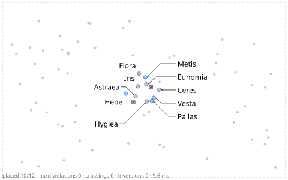
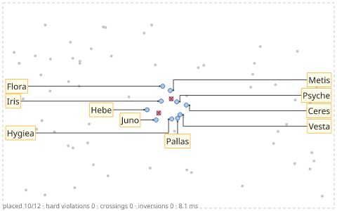
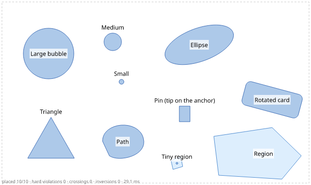
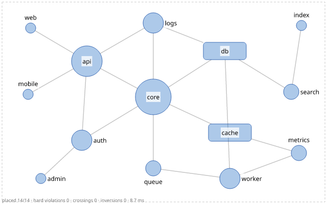
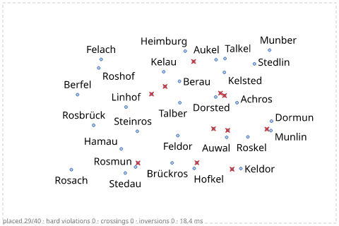

# Label Anything

!!! warning "Experimental"

    Label Anything is still experimental and under active development, not
    production-ready software. The problem format, the APIs of the language bindings and
    the placements themselves can change in any 0.x release, without deprecation. Try it
    and report what you find; pin an exact version if you build on it.

**Label placement for charts, maps and diagrams, from any language.** Label Anything
decides where labels go: it places text, icons, or anything with a size next to the
points and areas of scatterplots, maps, node-link diagrams and illustrations. It avoids
whatever you say should not be covered, draws leader lines when a label has to sit at a
distance, and never lets leaders cross. One problem goes in (JSON, or your language's
API), one result comes out: a box per label, its leader, and an explanation for every
label that did not fit.

The *anything* is the host and the label: one engine for any chart, map or diagram and
any label with a size, where adjustText (matplotlib), ggrepel (ggplot2) or vega-label
(Vega) each serve one plotting library. Labels go to points and areas of any shape;
lines such as roads or rivers are obstacles, not labeled features. Label Anything places
labels in graphics: it is not a tool for labeling data, and it is unrelated to the
few-shot segmentation model of the same name (ECAI 2025).

{ width="640" }

<div class="grid cards" markdown>

-   **Graded avoidance**

    ---

    Per obstacle class, labels and leaders get `"hard"`, `"ignore"` or a weight. "Never
    cover outliers, covering other points costs a little, never cross a leader" is one
    line of configuration. [Avoidance](concepts/avoidance.md)

-   **Priority-driven omission**

    ---

    When not everything fits, your priority decides what is dropped — data attributes,
    outlierness, tiers, coverage per category, or a callback — and every omitted label
    says why and who is in its way. [Priority](tutorials/priority.md)

-   **Shape-aware**

    ---

    Circles, ellipses, rotated rectangles, polygons, paths, icons with a tip, areas.
    Labels touch the true outline; large shapes get internal labels, small ones external
    labels or leaders. [Shapes](tutorials/shapes.md)

-   **Any background**

    ---

    Nothing, vector shapes, an SVG classified with CSS selectors, or a raster image in
    one of five modes (ink, alpha, cost, classmap, saliency).
    [SVG](tutorials/svg-background.md) · [raster](tutorials/raster-backgrounds.md)

-   **Deterministic**

    ---

    The same input and seed give the same result on every machine: the time budget is
    turned into an iteration budget, and floating-point work is specified operation by
    operation. [Solver](concepts/solver.md)

-   **Every language**

    ---

    A Rust core with Python, Java, C/Go and WebAssembly bindings, a pure TypeScript
    port that reproduces its results, a CLI and an HTTP server — all on one versioned
    JSON format. [Getting started](getting-started/index.md)

</div>

## Five lines

The outliers above, labeled from every language. The chart is an image (`scatter.png`),
`outliers.csv` lists the points to label; labels avoid the drawn dots, the axes and the
trend line, and each other ([the tutorial](tutorials/outliers.md)).

=== "Python"

    ```python
    --8<-- "examples/tutorials/python/outliers.py:five"
    ```

=== "JavaScript"

    ```js
    --8<-- "examples/tutorials/js/outliers.mjs:five"
    ```

=== "Java"

    ```java
    --8<-- "examples/tutorials/java/Outliers.java:five"
    ```

=== "C"

    ```c
    --8<-- "examples/tutorials/c/outliers.c:five"
    ```

=== "Go"

    ```go
    --8<-- "examples/tutorials/go/outliers/main.go:five"
    ```

=== "CLI"

    ```sh
    --8<-- "examples/tutorials/cli/outliers.sh:five"
    ```

All six build the same problem and get the same result: the engines are deterministic,
and the TypeScript port reproduces the Rust core bit for bit.

## Gallery

Debug renderings of the tutorial problems (`label-anything render problem.json
result.json -o x.png`): item shapes in blue, obstacles in grey, labels in black on white
boxes, leaders in black, omitted labels as red crosses.

<div class="grid cards la-gallery" markdown>

-   

    Elbow leaders out of a dense cluster. [Leaders](tutorials/leaders.md)

-   

    Boundary labels in the margins, orthogonal leaders. [Leaders](tutorials/leaders.md)

-   

    True shapes: internal labels where they fit. [Shapes](tutorials/shapes.md)

-   

    Node-link diagram: edges are obstacles, hubs come first. [Graphs](tutorials/node-link.md)

-   

    An SVG chart classified by CSS selectors. [SVG](tutorials/svg-background.md)

-   

    Strict omission: the least important labels go first. [Priority](tutorials/priority.md)

</div>

Real data — charts, maps, photos, embeddings and networks from the benchmark, next to other
labelers — is in [the gallery](https://fabian-beck.github.io/label-anything/benchmark-report/gallery/),
published with the latest benchmark report.

## Benchmark

The [real-world benchmark](project/benchmark.md) scores Label Anything and six baselines
(naive, greedy, textalloc, adjustText, vega-label, ggrepel) on twelve scenarios built from
open data — software metrics, volcano plots, embeddings, airports on a world map, city
POIs on map tiles, node-link diagrams, illustrations, line charts, stress sizes,
interactive zooming and priority — with one implementation-independent evaluator.
[What the results show](project/benchmark.md#what-the-results-show): no overlaps and no
crossing leaders anywhere, more labels than the other tools that avoid every overlap — and
where it still falls short: dense data, moving labels, the largest problems' speed.

## Where next

* [Getting started](getting-started/index.md) in Python, JavaScript/TypeScript, Java, C,
  Go or on the command line.
* [Tutorials](tutorials/index.md): one task each, with code that runs in CI.
* [Concepts](concepts/index.md): the problem and result formats, avoidance, candidates,
  presets, the solver.
* [Reference](reference/index.md): the specification, defaults, presets, schemas and APIs.
