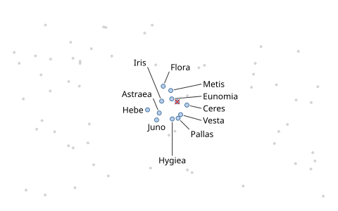
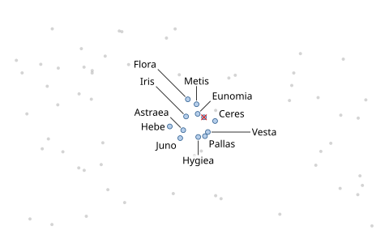
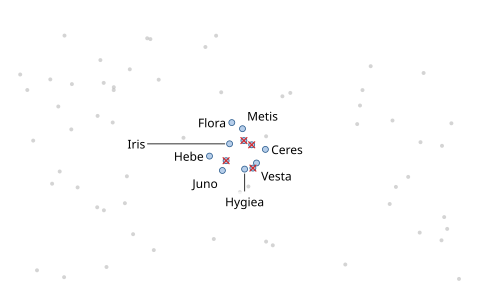
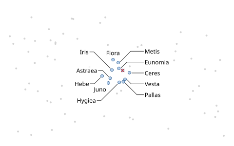
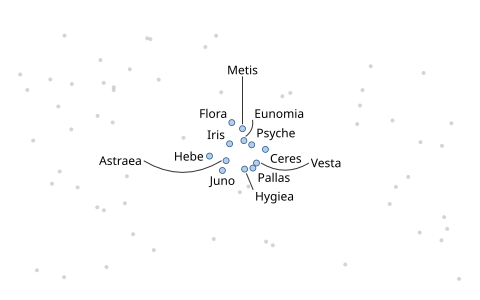
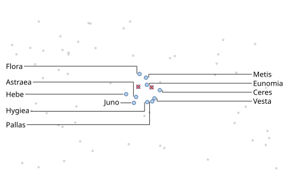

# Leaders and leader styles

When the space next to a feature is taken, a label can sit at a distance and point back
with a **leader**, drawn in one of five styles. Leaders never cross each other or pass
through labels, and they keep a distance from other marks and leaders: a leader that
grazes a dot seems to point at it, and two leaders very close together read as a crossing.

All examples label the same dense cluster of twelve asteroids among 60 unlabeled dots
(`points`, soft obstacles). Only the `leaders` line differs between the problems:

```json
--8<-- "examples/tutorials/problems/leaders-straight.json:1:6"
      ...
```

`placement.models` lets labels sit next to the mark (`adjacent`) or away from it on a
leader (`distant`), at most `max_distance` away.

## The five styles

=== "straight"

    ```json
    --8<-- "examples/tutorials/problems/leaders-straight.json:5:5"
    ```

    One segment from the mark to the nearest point of the label box (`port: "nearest"`).

    

=== "angles"

    ```json
    --8<-- "examples/tutorials/problems/leaders-angles.json:5:5"
    ```

    Straight, but only in the listed directions (degrees, 0 = right, 90 = up).

    

=== "orthogonal"

    ```json
    --8<-- "examples/tutorials/problems/leaders-orthogonal.json:5:5"
    ```

    Horizontal and vertical segments with at most one bend, preferring none; to labels in
    the margins, along the side and then into the label.

    

=== "elbow"

    ```json
    --8<-- "examples/tutorials/problems/leaders-elbow.json:5:5"
    ```

    A first segment at one of the `angles`, then horizontal into the middle of the
    label's side (`port: "side-center"`) — the classic callout of illustrations.

    

=== "curved"

    ```json
    --8<-- "examples/tutorials/problems/leaders-curved.json:5:5"
    ```

    A quadratic Bézier curve.

    

A red cross marks an omitted label. In a cluster this dense, a leader from an inner
asteroid would pass too close to its neighbours, so up to three asteroids find no place.
Curved leaders, which bend around the neighbours, lose none; orthogonal leaders, which
leave in only four directions, lose the most. With straight and elbow leaders, the labels
on the cluster's right form a column of [fan labels](../concepts/candidates.md#fan-labels).
Each omitted placement says why
([reading the explanations](priority.md#reading-the-explanations)).

## Leader options

| Option | Default | |
|---|---|---|
| `style` | `"straight"` | `straight`, `angles`, `orthogonal`, `elbow`, `curved` |
| `angles` | multiples of 45° | allowed directions for `angles` and the first segment of `elbow` |
| `port` | `"nearest"` | where the leader meets the label: `nearest` point, `side-center`, or `baseline` (the end of an underline below the first text line, reported as `leader.underline`) |
| `attach` | `"auto"` | where it leaves the feature: the mark's `boundary`, its `center`, or an icon's `tip` (`auto`: tip for icons, else boundary) |
| `anchor_gap` | 1.5 px | gap between the mark and the leader's start |
| `min_length` / `max_length` | 6 px / 10 em | a shorter leader is dropped and its label counts as adjacent; no leader is longer, except to boundary labels |
| `clearance` | 0.4 em | distance from other items' marks and from other leaders (except where two leaders of neighbouring marks start) |
| `min_angle_between` | 10° | distant leaders starting within 1 em of each other diverge at least this much |
| `width` | 1 px | stroke width for the collision tests |

Where distant labels may go (`min_distance`, `max_distance`, rings and directions) is set
in `placement` ([distant candidates](../concepts/candidates.md#candidate-models)).

The rules for what leaders may cross are the defaults of `avoid.leader`
([avoidance](../concepts/avoidance.md)): other leaders, labels and other items' marks are
hard; everything else costs 0.2 per em of leader over it (ink 0.05).

## Boundary labels

Technical illustrations and some charts put the labels in the margins, connected by
leaders. The `boundary` model stacks them in a column along each chosen side, as close to
their anchors' heights as possible (`align: "stack"`) or evenly spread (`"spread"`), in the
order that makes the leaders shortest, which also keeps straight leaders from crossing.

```json
--8<-- "examples/tutorials/problems/leaders-boundary.json:1:5"
```



`placement.boundary` also sets the `gap` between stacked labels and the `margin` from the
canvas edge. The `illustration` preset combines boundary and distant labels with elbow
leaders ([presets](../reference/presets.md)). `boundary` can also be a step of the
[degradation ladder](../concepts/candidates.md#the-degradation-ladder).

## In Python

```python
--8<-- "examples/tutorials/python/leaders.py:styles"
```

```python
--8<-- "examples/tutorials/python/leaders.py:boundary"
```

Each placement's `leader` has the polyline from the feature to the label (`points`), its
`style`, the `port` on the label, and for curved leaders the Bézier control points
(`curve`):

```python
--8<-- "examples/tutorials/python/leaders.py:read"
```
