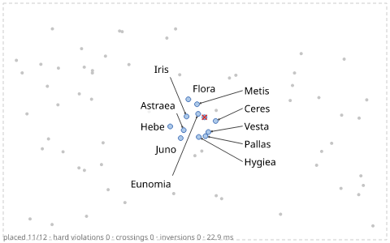
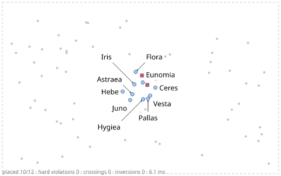
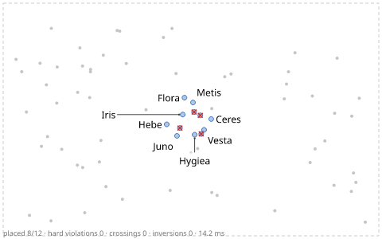
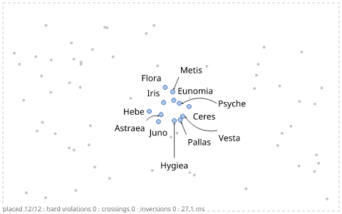

# Leaders and leader styles

When the space next to a feature is taken, a label can sit at a distance and point back
with a **leader**. Label Anything generates such *distant* candidates on rings around the
feature, draws the leader in one of five styles, and guarantees that leaders never cross
each other and never pass through labels. With *boundary* labels, the labels line up in
the margins instead.

All examples label the same dense cluster of twelve asteroids among 60 unlabeled dots
(`points`, soft obstacles). Only the `leaders` line differs between the problems:

```json
--8<-- "examples/tutorials/problems/leaders-straight.json:1:6"
      ...
```

`placement.models` enables the candidate models: `adjacent` (next to the mark) and
`distant` (at a distance, with a leader). `max_distance` bounds how far a label may move
(here 9 em, 108 px at the default 12 px font).

## The five styles

=== "straight"

    ```json
    --8<-- "examples/tutorials/problems/leaders-straight.json:5:5"
    ```

    One segment from the mark to the nearest point of the label box (`port: "nearest"`).

    

=== "angles"

    ```json
    --8<-- "examples/tutorials/problems/leaders-angles.json:5:5"
    ```

    Straight, but only in the listed directions (degrees, 0 = right, 90 = up): distant
    candidates are generated along these rays.

    

=== "orthogonal"

    ```json
    --8<-- "examples/tutorials/problems/leaders-orthogonal.json:5:5"
    ```

    Horizontal and vertical segments with at most one bend (two for boundary labels);
    fewer bends first.

    

=== "elbow"

    ```json
    --8<-- "examples/tutorials/problems/leaders-elbow.json:5:5"
    ```

    A first segment at one of the `angles`, then horizontal into the middle of the
    label's side (`port: "side-center"`) — the classic callout of illustrations.

    

=== "curved"

    ```json
    --8<-- "examples/tutorials/problems/leaders-curved.json:5:5"
    ```

    A quadratic Bézier curve; the result reports its control points in `leader.curve`
    and a flattened polyline in `leader.points` (used for the collision tests).

    

A red cross marks a label that was omitted: in the straight, angles and orthogonal
versions one asteroid finds no candidate that is free of the other labels, marks and
leaders. Its placement says so — `reason: "omitted_by_priority"` (all items have the same
priority here, so it lost to items processed before it), `blocking` lists the classes
that rejected its candidates and `blocked_by` the labels in its way. See
[priority and omission](priority.md).

## Leader options

| Option | Default | |
|---|---|---|
| `style` | `"straight"` | `straight`, `angles`, `orthogonal`, `elbow`, `curved` |
| `angles` | multiples of 45° | allowed directions for `angles` and the first segment of `elbow` |
| `port` | `"nearest"` | where the leader meets the label: `nearest` point, `side-center`, or `baseline` (the end of an underline below the first text line, reported as `leader.underline`) |
| `attach` | `"auto"` | where it leaves the feature: the mark's `boundary`, its `center`, or an icon's `tip` (`auto`: tip for icons, else boundary) |
| `anchor_gap` | 1.5 px | gap between the mark and the leader's start |
| `min_length` / `max_length` | 6 px / 10 em | shorter leaders are dropped (the label counts as adjacent); longer ones are not generated |
| `clearance` | 3 px | distance from other items' shapes and other leaders |
| `min_angle_between` | 10° | leaders of nearby items differ at least this much in direction |
| `width` | 1 px | stroke width for the collision tests |

Where distant labels go is set in `placement`: `min_distance` / `max_distance` (1.5 em /
8 em), `distant_rings` (4) and `distant_directions` (16, for straight leaders),
`free_space_seeds` (also try the centres of empty regions) and `k_distant` (candidates
kept per item, 24).

What leaders may cross is a separate map, `avoid.leader`: by default other leaders
(crossings) and labels are hard, item marks cost 2.0 and everything else 0.2.
[Avoidance](../concepts/avoidance.md) has the details.

## Boundary labels

Technical illustrations and some charts put the labels into the margins and connect them
with leaders. The `boundary` model stacks them along the chosen sides, as close to their
anchors' heights as possible (`align: "stack"`) or evenly spread (`"spread"`), and assigns
items to slots so that the total leader length is minimal — which also keeps straight
leaders from crossing.

```json
--8<-- "examples/tutorials/problems/leaders-boundary.json:1:5"
```


`placement.boundary` also has `gap` (between stacked labels, 2 px) and `margin` (distance
from the canvas edge, 4 px). The `illustration` preset combines boundary and distant labels
with elbow leaders ([presets](../reference/presets.md)). Boundary is also a step of the
degradation ladder: a label that fits nowhere else may end up in a margin
([candidates](../concepts/candidates.md#the-degradation-ladder)).

## In Python

```python
--8<-- "examples/tutorials/python/leaders.py:styles"
```

```python
--8<-- "examples/tutorials/python/leaders.py:boundary"
```

Each placement's `leader` has the polyline from the feature to the label (`points`), its
`style`, the `port` on the label, and for curved leaders the Bézier control points:

```python
--8<-- "examples/tutorials/python/leaders.py:read"
```

The program checks that each Python call gives the same placements as its JSON problem.
