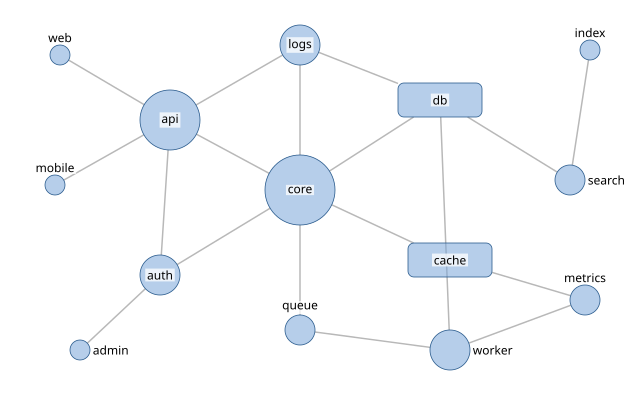

# Node-link diagrams

In a node-link diagram, labels compete with nodes of very different sizes and with edges
running everywhere. The approach: each node is an item whose mark is its true shape, large
nodes hold their labels inside, small ones get them beside, and edges are soft obstacles
that labels avoid where they can.

```json
--8<-- "examples/tutorials/problems/graph.json:1:12"
  "items": [ ... ]
}
```



* **Nodes are items.** A circle node's radius grows with its degree; the two servers are
  rounded rectangles. Labels never overlap a node (`items` is hard).
* **Internal labels.** The `graph` preset tries the `internal` model first: rectangles take
  their labels inside, and so do circles whose radius is at least 1.5 label heights, like
  the two hubs. Small nodes get adjacent labels.
* **Edges are obstacles.** They are `obstacles.vector` polylines of class `lines`, which
  cost 1.0 for labels and 0.5 for leaders in the `graph` preset. Draw them from outline to
  outline, as a renderer does, so that a label inside a node does not pay for edges hidden
  under it.
* **Priority by degree.** The built-in `degree` term counts the polyline ends that touch
  each node's mark (or reads `attrs.degree`): when space runs out, hubs are labeled first.

For labels that must move away, the `graph` preset draws `angles` leaders at multiples of
45° ([presets](../reference/presets.md)).

## In Python

```python
--8<-- "examples/tutorials/python/node_link.py:graph"
```

The program checks that this builds the same problem as `graph.json`.

## Cytoscape.js

`labelCytoscape` lets Cytoscape draw its own node labels and sets their positions
(`text-margin-x/y`), hiding omitted ones. It solves in model coordinates, so the layout
stays valid as you pan and zoom, and solves again after layouts, node drags and graph
changes. Unlabeled nodes are hard obstacles (`nodes`), edges soft ones (`edges`); leaders,
if enabled, go into an SVG overlay.

```js
--8<-- "examples/tutorials/js/browser/cytoscape.mjs:cytoscape"
```

## sigma.js

`labelSigma` replaces sigma's label renderer. Sigma draws labels at a fixed pixel size
while nodes move under the camera, so the helper solves in viewport pixels after each
camera move (debounced), starting from the previous result. Between solves, labels follow
their nodes; after one, they move and fade calmly
([smooth transitions](interactive-maps.md#smooth-transitions)).

```js
--8<-- "examples/tutorials/js/browser/sigma.mjs:sigma"
```

## Edges as obstacles

Edges can be any geometry: straight segments as above, polylines of orthogonal or bundled
edges, or the edges of an SVG drawing, which the `graph` preset's SVG rules classify as
`lines`. Make edges hard (`"avoid": {"label": {"lines": "hard"}}`) if labels must never
cross them, and expect more leaders and omissions.

## Layouts that move

While a force-directed layout runs or the user drags a node, solve every few ticks with
the previous result as `warm_start`: each label follows its node and moves on only when its
place is taken. [Moving points](interactive-maps.md#moving-points) shows this with
d3-force, and `LabelMotion` drawing the changes calmly.
