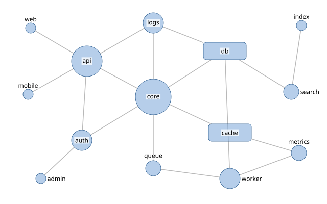
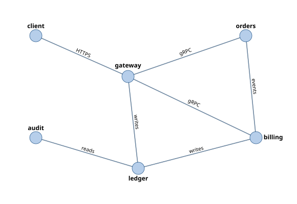

# Node-link diagrams

In a node-link diagram, labels compete with nodes of very different sizes and with edges
running everywhere.

```json
--8<-- "examples/tutorials/problems/graph.json:1:12"
  "items": [ ... ]
}
```



* **Nodes are items.** A circle node's radius grows with its degree; the two servers are
  rounded rectangles. Labels never overlap a node (`items` is hard).
* **Internal labels.** The `graph` preset tries the `internal` model first: rectangles take
  their labels inside, and so do circles whose radius is at least 1.5 label heights, like
  the two hubs. Small nodes get adjacent labels.
* **Edges are obstacles.** They are `obstacles.vector` polylines of class `lines`, which
  cost 1.0 for labels and 0.5 for leaders in the `graph` preset. Draw them from outline to
  outline, as a renderer does, so that a label inside a node does not pay for edges hidden
  under it.
* **Priority by degree.** The built-in `degree` term counts the polyline ends that touch
  each node's mark (or reads `attrs.degree`): when space runs out, hubs are labeled first.

For labels that must move away, the `graph` preset draws `angles` leaders at multiples of
45° ([presets](../reference/presets.md)).

## In Python

```python
--8<-- "examples/tutorials/python/node_link.py:graph"
```

## Cytoscape.js

`labelCytoscape` lets Cytoscape draw its own node labels and sets their positions
(`text-margin-x/y`), hiding omitted ones. It solves in model coordinates, so the layout
stays valid as you pan and zoom, and solves again after layouts, node drags and graph
changes. Unlabeled nodes are hard obstacles (`nodes`), edges soft ones (`edges`); leaders,
if enabled, go into an SVG overlay.

```js
--8<-- "examples/tutorials/js/browser/cytoscape.mjs:cytoscape"
```

## sigma.js

`labelSigma` replaces sigma's label renderer. Sigma draws labels at a fixed pixel size
while nodes move under the camera, so the helper solves in viewport pixels after each
camera move (debounced), starting from the previous result. The viewport is a
[window](interactive-maps.md#the-view-is-a-window) on the graph: nodes up to `overscan`
px beyond it are labeled as well (default: 8 times the font size; `false`: every label
inside the viewport), and a label at its edge is cut there. While the camera only pans
over the same graph, the labels are pinned: none moves (`pin: false`: warm starts alone). Between solves, labels follow
their nodes; after one, they move and fade calmly
([smooth transitions](interactive-maps.md#smooth-transitions)).

```js
--8<-- "examples/tutorials/js/browser/sigma.mjs:sigma"
```

## Edge labels

An edge with a label is an item too, with a `line` anchor: the points of the edge as it
is drawn, and the width of its stroke.

```json
--8<-- "examples/tutorials/problems/edge-labels.json:16:17"
```



* **Along the line.** The label stands above the middle of its edge, turned to the
  edge's direction and reading from left to right (upwards on a vertical edge), at
  `placement.offset` (1 px) from the stroke. The placement has a `rotation` about the
  center of its `box`, as the label of a [slanted area](shapes.md#area-anchors) has; with
  `"placement": {"line_rotation": 0}` every label stays upright beside its edge, and a
  smaller angle than the default 90° keeps the labels of steep edges upright.
* **Out of the way.** When a node, another label or a hard obstacle is in the way, the
  label moves along the edge (up to nine places from end to end) or to its other side.
  `position_order` chooses the sides and their order: `["bottom", "top"]` prefers the
  side below, `["top"]` allows only the one above.
* **On the line.** `"placement": {"internal": "prefer"}` on the item centers the label on
  the edge, for a host that draws it on a background. By default (`auto`) only a line at
  least as wide as its label is high carries it, such as a street on a map.
* **Corners.** A polyline may bend: an orthogonal or bundled edge is labeled on a stretch
  that is straight enough for the label (it leaves its chord by no more than the label's
  height), never across a corner. An edge without such a stretch gets its label beside
  a small dot halfway along it (`anchor.dot`), like any point.
* **Edges are still obstacles.** A `line` anchor keeps no other label off its line. List
  the edges under `obstacles` as before, so that the node labels avoid them; an edge's
  own label stands clear of its line.

In Python the anchor is `la.Line(points, width=1.5)`, in Java `Item.line(id, points)`.

## Edges as obstacles

Edges can be any geometry: straight segments as above, polylines of orthogonal or bundled
edges, or the edges of an SVG drawing, which the `graph` preset's SVG rules classify as
`lines`. Make edges hard (`"avoid": {"label": {"lines": "hard"}}`) if labels must never
cross them, and expect more leaders and omissions.

## Layouts that move

While a force-directed layout runs or the user drags a node, solve every few ticks with
the previous result as `warm_start`
([moving points](interactive-maps.md#moving-points)), and let `LabelMotion` draw the
changes calmly ([smooth transitions](interactive-maps.md#smooth-transitions)).
