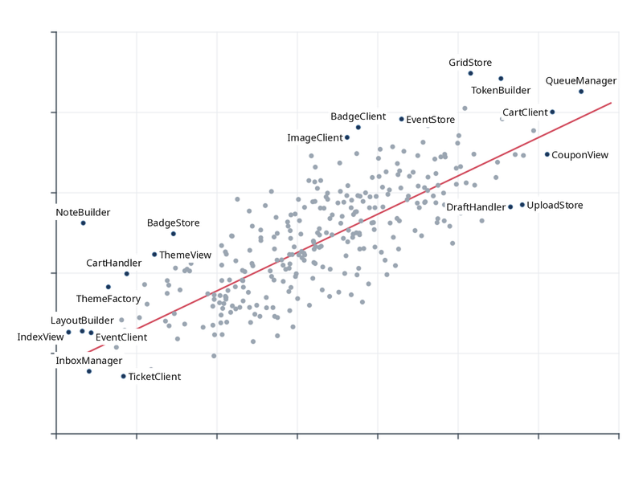

# Label your outliers in 5 lines

You have drawn a scatter plot and know which points are the interesting ones. Labeling
them should take five lines: name the points, hand over the chart, read back the boxes.

The chart is an image, `scatter.png` (800 × 600 px): 300 classes of a code base, size
against coupling, a trend line, axes. `outliers.csv` lists the 20 outliers in canvas
pixels (origin top-left, y down):

```text
--8<-- "examples/tutorials/data/outliers.csv:1:4"
...
```

## The five lines

=== "Python"

    ```python
    --8<-- "examples/tutorials/python/outliers.py:five"
    ```

=== "JavaScript"

    ```js
    --8<-- "examples/tutorials/js/outliers.mjs:five"
    ```

    In a browser, pass the chart's pixels instead of a file:
    `place(problem, { raster: ctx.getImageData(0, 0, 800, 600) })`.

=== "Java"

    ```java
    --8<-- "examples/tutorials/java/Outliers.java:five"
    ```

=== "C"

    ```c
    --8<-- "examples/tutorials/c/outliers.c:five"
    ```

    `read_file` loads the file into a string; the complete program is
    [`examples/tutorials/c/outliers.c`](gh:examples/tutorials/c/outliers.c).

=== "Go"

    ```go
    --8<-- "examples/tutorials/go/outliers/main.go:five"
    ```

=== "CLI"

    ```sh
    --8<-- "examples/tutorials/cli/outliers.sh:five"
    ```

    Or straight from the CSV file:

    ```sh
    --8<-- "examples/tutorials/cli/outliers.sh:csv"
    ```

C, Go and the CLI read the problem as JSON. It is what the other languages build:

```json
--8<-- "examples/tutorials/data/outliers.json:1:6"
    ...
  ]
}
```

## What happened



Every label sits next to its point, touching the point's mark (a circle of radius 2 by
default) at a 2 px offset, and no two labels overlap. In detail:

* **The background.** `scatter.png` became a raster obstacle in `ink` mode: the most
  frequent border colour (white) is the background, every pixel that differs from it by
  more than an OKLab distance of 0.12 is *ink*, and the ink is averaged into a coverage
  grid of 3 px cells (a quarter of the 12 px font size). The light grid lines are close
  enough to white not to count. Without a `canvas`, the canvas is the image size.
* **The preset.** `scatter` makes covering ink cost 0.1 per em² of covered area: labels
  prefer empty space but may touch a dot when nothing better exists. Labels never overlap
  other labels, other items' marks or their own mark (`hard` by default) and stay 4 px
  inside the canvas. [Avoidance](../concepts/avoidance.md) explains the classes.
* **The candidates.** Each label is tried at 8 positions around its mark (top first), at
  4 sliding positions between each pair and — with the `scatter` preset — at a distance
  with a leader. When none of them is free, the degradation ladder tries shorter
  alternatives, wrapping, a leader, evicting a less important label, shrinking — and
  finally omits the label ([candidates](../concepts/candidates.md)).
* **The result.** One placement per item, in input order: `box` (x, y, w, h in canvas
  px), `anchor_side` (`right`, `top-left`, …), `model` (`adjacent`, `slider`, …), `leader`
  (`null` here) and the text layout (`lines`, `baseline_offsets`). `stats` says
  `placed: 20, hard_violations: 0, leader_crossings: 0` — the last two come from an
  independent verification pass. [The result format](../concepts/result.md) lists every
  field.

All six programs build the same problem and get the same boxes: the Rust core is
deterministic, and the TypeScript engine reproduces its decisions.

## Variations

* **Too many outliers.** With hundreds of candidates, let the engine choose: pass every
  point and `priority=la.Priority.outlierness()` with `max_labels=15` — the
  [matplotlib helper example](../getting-started/python.md#matplotlib) does exactly that.
* **Never touch the dots.** `avoid={"ink": "hard"}` turns the ink into a hard obstacle;
  labels that cannot avoid it get leaders ([raster backgrounds](raster-backgrounds.md)).
* **An SVG chart.** With the chart as SVG, dots, lines and text become separate obstacle
  classes with their own weights ([SVG backgrounds](svg-background.md)).
* **Data coordinates.** `transform` maps data units to pixels and `y_axis: "up"` flips
  the y axis ([the problem format](../concepts/problem.md#coordinates)); the plotting
  helpers do this for you.
