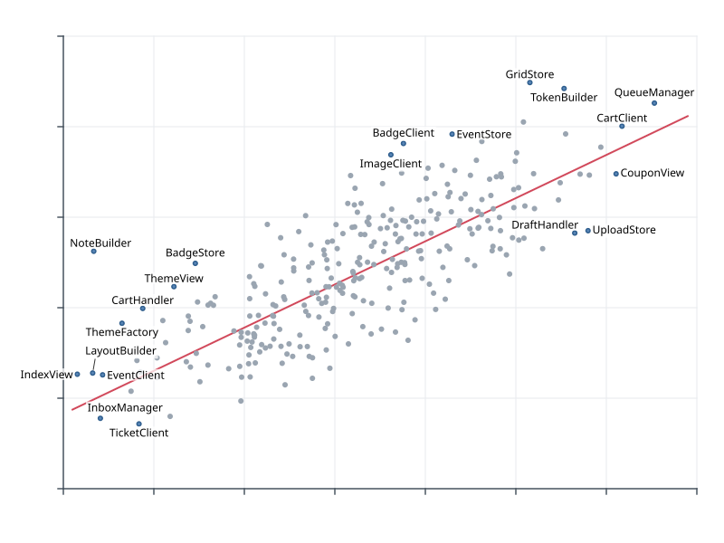

# Label your outliers in 5 lines

You have drawn a scatter plot and know which points are the interesting ones. Labeling
them should take five lines: name the points, hand over the chart, read back the boxes.

The chart is an image, `scatter.png` (800 × 600 px): 300 classes of a code base, size
against coupling, a trend line, axes. `outliers.csv` lists the 20 outliers in canvas
pixels (origin top-left, y down):

```text
--8<-- "examples/tutorials/data/outliers.csv:1:4"
...
```

## The five lines

=== "Python"

    ```python
    --8<-- "examples/tutorials/python/outliers.py:five"
    ```

=== "JavaScript"

    ```js
    --8<-- "examples/tutorials/js/outliers.mjs:five"
    ```

    In a browser, pass the chart's pixels instead of a file:
    `place(problem, { raster: ctx.getImageData(0, 0, 800, 600) })`.

=== "Java"

    ```java
    --8<-- "examples/tutorials/java/Outliers.java:five"
    ```

=== "C"

    ```c
    --8<-- "examples/tutorials/c/outliers.c:five"
    ```

    `read_file` loads the file into a string; the complete program is
    [`examples/tutorials/c/outliers.c`](gh:examples/tutorials/c/outliers.c).

=== "Go"

    ```go
    --8<-- "examples/tutorials/go/outliers/main.go:five"
    ```

=== "CLI"

    ```sh
    --8<-- "examples/tutorials/cli/outliers.sh:five"
    ```

    Or straight from the CSV file:

    ```sh
    --8<-- "examples/tutorials/cli/outliers.sh:csv"
    ```

C, Go and the CLI read the problem as JSON, the same problem the other languages build:

```json
--8<-- "examples/tutorials/data/outliers.json:1:6"
    ...
  ]
}
```

## What happened



Each label touches its point's mark (by default a circle of radius 2), keeps 0.2 em from
other labels and marks (`defaults.margin`) and stays 4 px inside the canvas. In detail:

* **The background.** `scatter.png` became a raster obstacle in `ink` mode: every pixel
  that differs clearly from the background colour (white) is *ink*; the light grid lines
  are close enough to white not to count. Without a `canvas`, the canvas is the image
  size.
* **The preset.** With `scatter`, covering ink costs 0.1 per em²: labels prefer empty
  space but may touch a dot when nothing better is free
  ([avoidance](../concepts/avoidance.md)).
* **The candidates.** Each label is tried at 8 positions around its mark (top first), at 4
  sliding positions between neighbouring ones and, with the `scatter` preset, at a distance
  on a leader. If none is free, the degradation ladder tries shorter alternatives,
  wrapping, a leader, evicting a less important label and shrinking, and finally omits the
  label ([candidates](../concepts/candidates.md)).
* **The result.** One placement per item, in input order: `box` (x, y, w, h in canvas
  px), `anchor_side` (`right`, `top-left`, …), `model` (`adjacent`, `slider`, …), `leader`
  (`null` here) and the text layout (`lines`, `baseline_offsets`). `stats` reports
  `placed: 20, hard_violations: 0, leader_crossings: 0`, the last two counted by an
  independent check ([the result format](../concepts/result.md)).

All six programs get the same boxes.

## Variations

* **Too many outliers.** Let the engine choose: pass every point with
  `priority=la.Priority.outlierness()` and `max_labels=15`, as the
  [matplotlib helper example](../getting-started/python.md#matplotlib) does.
* **Never touch the dots.** `avoid={"ink": "hard"}` makes the ink a hard obstacle; labels
  without a free place beside their dot get leaders
  ([raster backgrounds](raster-backgrounds.md)).
* **An SVG chart.** With the chart as SVG, dots, lines and text become separate obstacle
  classes with their own weights ([SVG backgrounds](svg-background.md)).
* **Data coordinates.** `transform` maps data units to pixels and `y_axis: "up"` flips
  the y axis ([the problem format](../concepts/problem.md#coordinates)); the plotting
  helpers do this for you.
