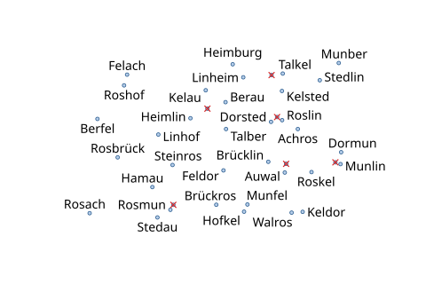

# Priority and omission

Most real labeling problems do not fit: forty city names in a small map, a thousand
classes in a scatter plot. Something must be left out, and *what* should be your decision,
not an accident of input order or search luck. In Label Anything a **priority** orders the
items, an **omission mode** says what that order guarantees, and every omitted label comes
with an **explanation**.

The examples label 40 cities in a 480 × 320 canvas at 14 px, where not all names fit.
Each city has a population, a region and possibly a capital flag:

```python
--8<-- "examples/tutorials/python/priority.py:data"
```

## Explicit priorities

The simplest priority is a number per item (`item.priority` in JSON): higher is more
important.

```python
--8<-- "examples/tutorials/python/priority.py:explicit"
```

With the default [omission mode](#omission-modes), `strict`, no less important label ever
takes the place of a more important one.

## Reading the explanations

```python
--8<-- "examples/tutorials/python/priority.py:explain"
```

```text
Walros omitted_by_priority ('items', 'labels') ('Hofkel',) {'tier': 0, 'score': 6882.0, 'rank': 37}
Brücklin omitted_by_priority ('items', 'labels', 'leaders') ('Achros', 'Feldor', 'Dorsted', 'Talber') {'tier': 0, 'score': 2554.0, 'rank': 39}
Linsted no_feasible_candidate ('items',) () {'tier': 0, 'score': 9409.0, 'rank': 35}
...
Berau omitted_by_priority ('items', 'labels') ('Kelsted',) {'tier': 0, 'score': 66376.0, 'rank': 13}
...
['Brücklin', 'Walros', 'Linsted', 'Achheim', 'Munfel', 'Aufel', 'Dormun', 'Talheim', 'Linheim', 'Munham', 'Heimlin', 'Berau']
0
```

Seven cities give way to more important labels. Five, Linsted among them, have no place at
all: beside each, a label would come closer to another city's mark than the label margin
(`defaults.margin`, 0.2 em).

Each omitted item reports:

* `reason` — why it is not labeled:

    | reason | meaning |
    |---|---|
    | `omitted_by_priority` | its candidates are blocked by placed labels or leaders (of higher or equal priority in `strict` mode), or it was cut by `prefix` or `max_labels` |
    | `no_feasible_candidate` | every candidate violates a hard constraint by itself: the canvas edge, a hard obstacle class, its own mark, another item's mark or the margin around it |
    | `budget_exhausted` | the solve was cancelled before the item was reached, or hit its time guard and the item had no free normal position (its degraded variants were not tried) |
    | `keep_with` | another member of its all-or-none set could not be placed |
    | `grouped` | it shares a group label with other items (`item.group`) |

* `blocking` — the hard classes that rejected its candidates, most frequent first
  (`labels`, `items`, `leaders`, `canvas_edge`, or obstacle classes).
* `blocked_by` — the placed items whose label or leader conflicts with its best candidates.
* `priority` — its `tier`, `score` and `rank` in the total priority order (0 = first).

What to do when a label you need is missing, by what blocks it:

| `blocking` | try |
|---|---|
| `items` (an important item in a crowd of minor ones) | let it cover their marks: `avoid.label.lower_items` ([below](#important-labels-over-minor-marks)); or a smaller `defaults.margin` |
| `labels`, `leaders` | raise its priority, or `required: true`; allow leaders (`placement.models` with `distant`, or the `boundary` model for margin labels) |
| `canvas_edge` | `canvas.padding: 0`, a larger canvas, or `canvas.allow_outside: true` |
| an obstacle class (`ink`, `lines`, `text`, …) | make it soft: a weight instead of `"hard"` in `avoid.label` |

`stats.omission_order` lists the omitted ids from the lowest priority up.
`stats.priority_inversions` counts omitted items that would have fit beside the more
important labels; in `strict` and `prefix` mode it is 0. `stats.placed_weighted` (0–1)
weighs the placed labels by rank, so the top of the order counts more than its tail.

## Priority terms

Instead of numbers, describe the priority by **terms** that the engine evaluates per item:
an attribute, a built-in measure or an [expression](../reference/expressions.md). Each raw
value is transformed (`log1p`, `sqrt`, `neg`, `abs`), normalized over all items and
weighted; the score is their sum. The default normalization, `rank`, keeps only the order
of a term's values, so a transform such as `log1p` has an effect only with `minmax` or
`none`, as below.

```python
--8<-- "examples/tutorials/python/priority.py:terms"
```

| built-in term | raw value (larger = more important) |
|---|---|
| `outlierness` | gap to the `k`-th nearest neighbour (default 5) among the items' marks and the `points` class |
| `isolation` | gap to the nearest neighbour |
| `crowding` | −isolation |
| `label_size` | area of the label in em² (negative weight: prefer short labels) |
| `mark_size` | area of the mark in px² |
| `centrality` | −distance to `priority.focus` (default: the canvas center) |
| `degree` | `attrs.degree`, else the number of `obstacles.vector` polyline ends on the mark |
| `input_order` | earlier items first |

## Tiers and required items

A **tier** outranks every score: all items of tier 1 come before all items of tier 0.
Rules `{where, tier}` assign tiers by expression (the first match wins); `item.tier` sets
one directly. `item.required: true` ranks above every tier.

```python
--8<-- "examples/tutorials/python/priority.py:tiers"
```

## Coverage

"Label at least two cities per region, while there is room": `coverage` reserves the top
`min_per_group` items of each group of `by` (an expression), which then rank above all
other items of their tier.

```python
--8<-- "examples/tutorials/python/priority.py:coverage"
```

## All or none

Items with the same `keep_with` name (or a list of item ids) are placed together or not at
all, e.g. a value and its unit, or the two ends of a route.

```python
--8<-- "examples/tutorials/python/priority.py:keep-with"
```

## Expressions

Terms (`expr`), tier rules (`where`) and coverage (`by`) use a small, safe expression
language over the item: `attrs`, `id`, `index`, `text`, `priority`, `tier`, `x`, `y`,
arithmetic, comparisons, `in [...]` and functions such as `log`, `len`, `startsWith` and
`coalesce` ([reference](../reference/expressions.md)). In terms, booleans count as 1 or 0.

```python
--8<-- "examples/tutorials/python/priority.py:expr"
```

## A priority function

In Python, JavaScript (`PlaceOptions.priority`) and Java (`Priority.callback`), a function
can compute each item's priority, a score or `(tier, score)`, once before the solve.

```python
--8<-- "examples/tutorials/python/priority.py:callable"
```

## Omission modes

* `strict` (default) — an omitted label would not fit even if only the labels of higher
  or equal priority were placed; within that, as many labels as possible.
* `prefix` — the placed labels are a prefix of the priority order: every label more
  important than a shown one is shown.
* `weighted` — maximize the sum of the (non-negative) scores, tiers strictly first;
  inversions are allowed and reported.

`max_labels` caps the number of labels, in priority order, and `max_ink_fraction` the
share of the canvas they cover; `band` treats scores closer than `band` as equal; `ties`
breaks ties between equal keys (`input_order`, `id`, `anchor_x`, `random`).

```python
--8<-- "examples/tutorials/python/priority.py:modes"
```

```text
strict   placed 25  inversions 0  placed_weighted 0.717
prefix   placed 14  inversions 0  placed_weighted 0.506
weighted placed 25  inversions 0  placed_weighted 0.711
```

## Important labels over minor marks

By default every mark keeps every other item's label away, whatever the priorities: in a
crowd, the dots of minor items can leave an important item no place. With
`avoid.label.lower_items` set to a weight, a label may cover the marks of less important
items, which then stay unlabeled: a mark is labeled or covered, never both
(`avoid.leader.lower_items` lets leaders pass such marks). On a world map of the 1,000
busiest airports, this brings back the labels of ATL, ORD, LHR, CDG and FRA, which the
dots of smaller airports nearby had blocked.

```json
{"avoid": {"label": {"lower_items": 10}, "leader": {"lower_items": 2.5}}}
```

The `map` preset sets these values, as do the plotting and map helpers whenever you give
them a priority; `"lower_items": "hard"` keeps every mark clear again
([ADR priority/lower-items](../adr/priority/lower-items.md)).

## Type size by importance

The priority can also set the type size, as on a map where the capital is set larger than
the villages: `font_classes` gives the most important labels larger or bolder text. Each
class takes the next stretch of the priority order up to its `first`, a number of items or
a share like `"25%"` counted from the top; the last class may take the rest.

```python
--8<-- "examples/tutorials/python/priority.py:font-classes"
```

The scale applies to the text and to lengths in em, such as the offset and the padding;
lengths in px, icons and boxes keep their size. Each placement reports its class
(`priority.font_class`) and the size and weight to draw (`text.font_size`,
`text.font_weight`).

## In JSON

```json
--8<-- "examples/tutorials/problems/priority-cities.json:1:13"
    ...
  ]
}
```



The red crosses mark the eleven omitted cities. The same in Python:

```python
--8<-- "examples/tutorials/python/priority.py:full"
```
