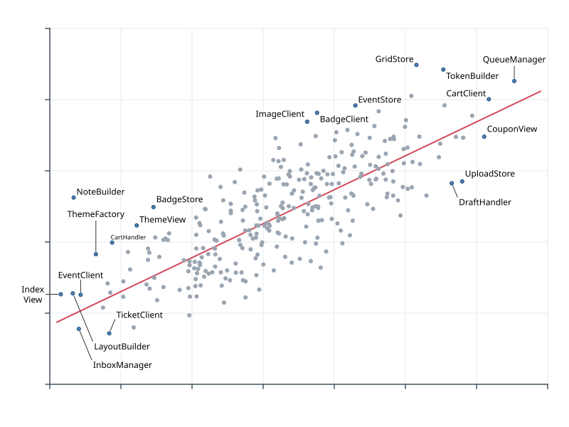
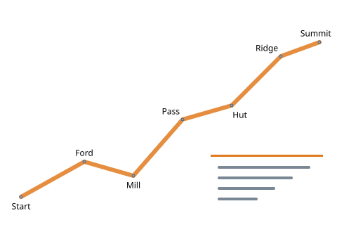
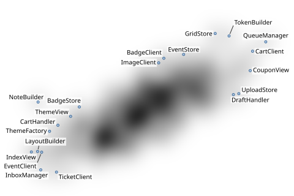
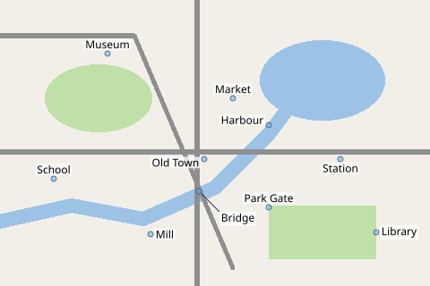
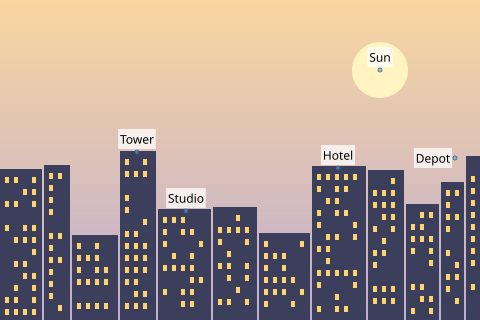
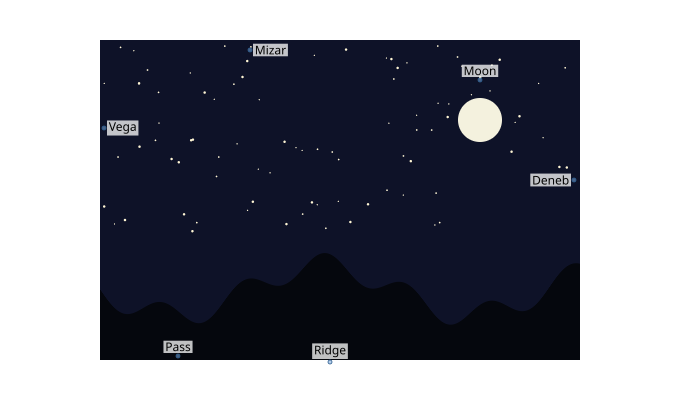
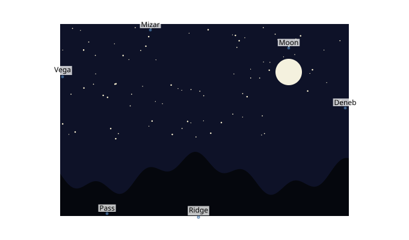

# Raster backgrounds

When the background is an image — a chart exported as PNG, a map tile, a photo, a canvas —
Label Anything turns its pixels into obstacle coverage. A **mode** gives each pixel a
value between 0 and 1; the values are averaged into the coverage grid of an obstacle class
(cells of about a quarter of the font size), which `avoid` weighs like any other class.

| Mode | A pixel counts by | Typical image |
|---|---|---|
| `ink` (default) | its colour distance from the background colour | charts, line art, maps on a plain background |
| `alpha` | its opacity | a transparent overlay layer |
| `cost` | its darkness (1 − luma), or brightness with `cost.invert` | density maps, heatmaps, hand-painted cost |
| `classmap` | its palette colour, one class per colour | flat-coloured maps: water, parks, roads |
| `saliency` | local detail (gradient magnitude and contrast) | photos, illustrations |

Raster sources go in `obstacles.raster` (one object or a list), with the image as
`source` (a file path, a `data:` URL, or base64 PNG, JPEG or WebP) or as raw pixels
(`rgba`, or [from memory](#in-python) in each language). `scale` is raster pixels per
canvas pixel (2 for a HiDPI screenshot of a 1× canvas), `offset` the canvas position of the
image's top-left corner, and `class` the obstacle class (default `ink`). Without a
`canvas`, the canvas is the image size divided by `scale`.

Each section below shows the start of a problem from
[`examples/tutorials/problems`](gh:examples/tutorials/problems) and its result.

## ink

The chart of the [outliers tutorial](outliers.md), with ink made **hard**: labels may not
touch a single drawn pixel. Where a point has no free place beside it, its label moves away
on a leader (leaders cross ink at a cost of 0.5).

```json
--8<-- "examples/tutorials/problems/raster-ink.json:1:10"
```



* `ink.background`: the background colour, `"#rrggbb"`, or `"auto"` (default): the most
  frequent colour of the image's border.
* `ink.threshold`: how different from the background a pixel must be to count as ink. The
  default, 0.12, ignores the light grey grid lines and counts the grey dots.
* `ink.dilate`: grows the ink by a safety margin of grid cells (default 1).

## alpha

A transparent layer — here a route and a callout box, with nothing behind them. Pixels
whose opacity exceeds `alpha.threshold` (0.1) count, whatever their colour.

```json
--8<-- "examples/tutorials/problems/raster-alpha.json:1:5"
```



The class `route` costs 5: labels stay off the route and the callout box unless there is
no other place.

## cost

A grayscale cost map: dark is expensive. This one is the density of the scatter plot's
300 points, so labels drift towards the sparse areas.

```json
--8<-- "examples/tutorials/problems/raster-cost.json:1:7"
```



Give the class a weight, not `"hard"`: with `"hard"`, any pixel that is not white would
block.

## classmap

A map in flat colours. Each palette colour becomes its own class — water, parks, roads —
with its own weights: labels never sit on water, rarely on roads, and do not mind parks.

```json
--8<-- "examples/tutorials/problems/raster-classmap.json:1:14"
```



A pixel belongs to the nearest palette colour within `classmap_tolerance` (an OKLab
distance, 0.08). Background pixels (as in `ink`) are skipped; other unmatched pixels go to
`ink`, or nowhere with `"unmatched": "ignore"`. A palette entry may map to `"ignore"`.
Anti-aliased edges blend two palette colours and may match neither: render classmaps
without anti-aliasing, or raise the tolerance.

## saliency

For photos, where nothing is "background": smooth sky is cheap, windows and edges are
expensive.

```json
--8<-- "examples/tutorials/problems/raster-saliency.json:1:6"
```



## Contrast borders

In any mode, labels also avoid straddling a border between light and dark: half on the
white page and half on a dark photo, or half on a black road and half on a light field.
Here `ink` sees only the stars and the moon, since the night sky is the raster's background
colour, and the white page around the picture is no raster at all. Only the contrast cost
keeps the labels of Vega, Mizar and Deneb off the picture's edge.

```json
--8<-- "examples/tutorials/problems/raster-contrast.json:1:7"
```



With `"weights": {"contrast": 0}` they take the first free position instead, across the
edge:



The cost (`weights.contrast`) grows with how much the lightness behind a label varies.
The backdrop is the raster sources over `canvas.background`, white unless you set the
colour the host draws on. It is averaged over about half an em, so thin lines and fine
texture hardly count; the modes above handle those.

## In Python

A path with mode options, as in the JSON problems above:

```python
--8<-- "examples/tutorials/python/raster_backgrounds.py:file"
```

Pixels from memory — a NumPy `uint8` array (H × W × 4, × 3 or grey), a PIL image — go to
the engine without a detour through JSON:

```python
--8<-- "examples/tutorials/python/raster_backgrounds.py:numpy"
```

`la.capabilities()` lists the image formats this build decodes:

```python
--8<-- "examples/tutorials/python/raster_backgrounds.py:capabilities"
```

Other languages pass pixels the same way: `PlaceOptions.raster` in
[JavaScript](../getting-started/javascript.md#raster-pixels-and-files),
`backgroundPixels(...)` in [Java](../getting-started/java.md#raster-pixels-without-copies),
the `rgba` pointer of `la_place_json` in [C](../getting-started/c-go.md#c).

## Exactness

PNG and raw pixels give the same coverage in every implementation
([spec §4.6](../reference/spec.md#46-raster-backgrounds)). JPEG and WebP are decoded by
the platform and may differ by a few pixel values.
