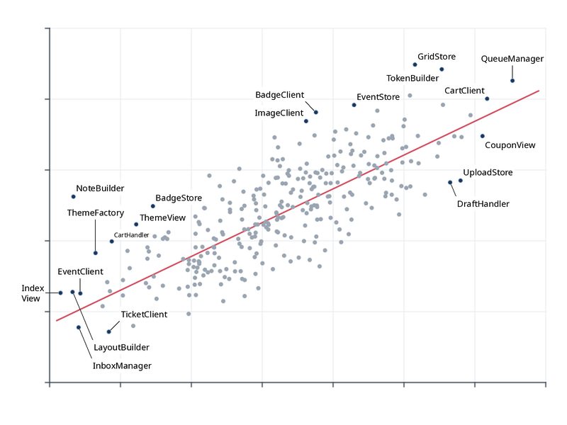
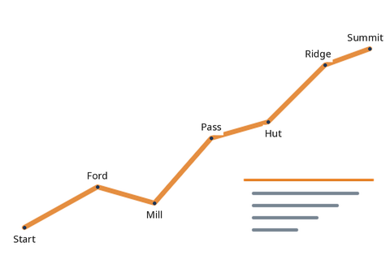
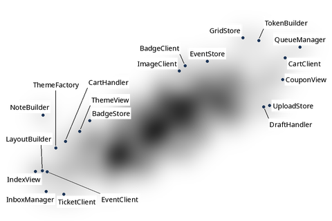
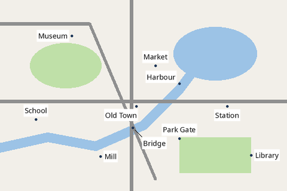
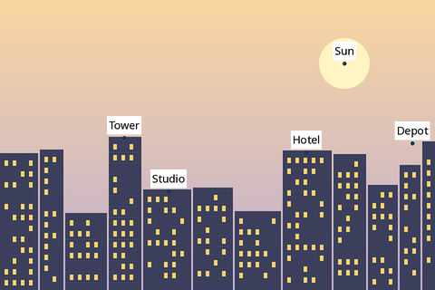
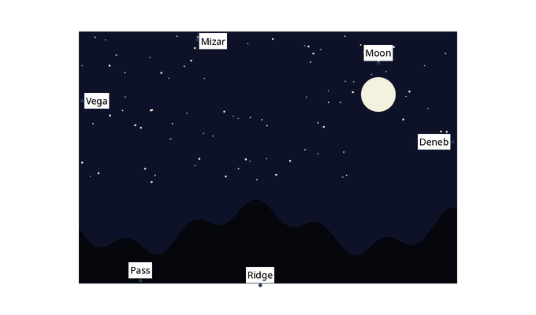
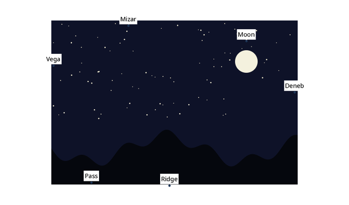

# Raster backgrounds

When the background is an image — a chart exported as PNG, a map tile, a photo, a canvas —
Label Anything turns its pixels into obstacle coverage. A **mode** gives every pixel a
value between 0 and 1; the values are averaged into the coverage grid (cells of about a
quarter of the font size) of an obstacle class, which `avoid` then weighs like any other
class.

| Mode | A pixel counts by | Typical image |
|---|---|---|
| `ink` (default) | its colour distance from the background colour | charts, line art, maps on a plain background |
| `alpha` | its opacity | a transparent overlay layer |
| `cost` | its darkness (1 − luma), or brightness with `cost.invert` | density maps, heatmaps, hand-painted cost |
| `classmap` | its palette colour, one class per colour | flat-coloured maps: water, parks, roads |
| `saliency` | local detail (gradient magnitude and contrast) | photos, illustrations |

A raster source is `obstacles.raster` (one object or a list) with the image as `source` (a
file path, a `data:` URL or base64 PNG/JPEG/WebP) or as raw pixels (`rgba`, or passed by
the host: NumPy, `ImageData`, a `ByteBuffer`, a C pointer). `scale` is raster pixels per
canvas pixel (2 for a HiDPI screenshot of a 1× canvas), `offset` the canvas position of
the image's top-left corner, `class` the obstacle class (default `ink`). Without a
`canvas`, the canvas is the image size divided by `scale`.

Each section below shows the head of a problem of
[`examples/tutorials/problems`](gh:examples/tutorials/problems) and the labels as a host
would draw them.

## ink

The chart of the [outliers tutorial](outliers.md), with ink made **hard**: labels may not
touch a single drawn pixel. Where no free spot exists next to a point, the label moves
away with a leader (soft ink cost 0.5 for leaders).

```json
--8<-- "examples/tutorials/problems/raster-ink.json:1:10"
```



* `ink.background`: `"auto"` takes the most frequent colour of the image's border pixels;
  or give `"#rrggbb"`.
* `ink.threshold`: the OKLab distance from the background above which a pixel is ink
  (0.12: the light grey grid lines, 0.07 from white, do not count; the grey dots, 0.28,
  do).
* `ink.dilate`: grows the ink by this many grid cells (1), a safety margin.

A hard raster class is tested on its grid: a label touches it when it overlaps a cell
with any coverage, so hard raster obstacles are exact up to one cell and never
optimistic.

## alpha

A transparent layer — here a route and a callout box, with nothing behind them. Pixels
whose opacity exceeds `alpha.threshold` (0.1) count, whatever their colour.

```json
--8<-- "examples/tutorials/problems/raster-alpha.json:1:5"
```



The class is named `route` and costs 5: labels stay off the route and the callout box
unless nothing else is possible.

## cost

A grayscale cost map: dark is expensive. This one is the density of the 300 points of the
scatter plot, scaled to 480 × 320: labels drift towards the sparse areas.

```json
--8<-- "examples/tutorials/problems/raster-cost.json:1:7"
```



A pixel's value is 1 − luma (Rec. 709) of the pixel composited over white, or its luma
with `"cost": {"invert": true}`. Cost maps are soft by nature: give the class a weight,
not `"hard"` (any non-white pixel would block).

## classmap

A map in flat colours. Each palette colour becomes its own class — water, parks, roads —
with its own weights: labels never sit on water, rarely on roads, and do not mind parks.

```json
--8<-- "examples/tutorials/problems/raster-classmap.json:1:14"
```



A pixel goes to the nearest palette colour within `classmap_tolerance` (OKLab, 0.08).
Background pixels (as in `ink`) are skipped; other unmatched pixels go to `ink`, or
nowhere with `"unmatched": "ignore"`. A palette entry may map to `"ignore"`. Anti-aliased
edges blend two palette colours and may fall between them: render classmaps without
anti-aliasing, or raise the tolerance.

## saliency

For photos, where nothing is "background": saliency combines the Sobel gradient magnitude
of the luma with the local contrast (luma against its 5 × 5 mean), each normalized by its
maximum over the image. Smooth sky is cheap, windows and edges are expensive.

```json
--8<-- "examples/tutorials/problems/raster-saliency.json:1:6"
```



## Contrast borders

Whatever the mode, labels also avoid lying across a border between a light and a dark
backdrop: partly on the white page and partly on a dark photo, or half on a black road
and half on a light field. Here the night sky is the raster's own background colour, so
`ink` sees only the stars and the moon, and the white page around the picture is no raster
at all: nothing else would stop the labels of Vega, Mizar and Deneb from straddling the
picture's edge.

```json
--8<-- "examples/tutorials/problems/raster-contrast.json:1:7"
```



With `"weights": {"contrast": 0}` they take the first free position instead, across the
edge:



* The engine samples the luma of what lies behind the labels (Rec. 709, as in `cost`): the
  raster sources in order, transparent pixels letting what lies below show through, over
  `canvas.background` (default `"#ffffff"`; set it when the host draws on another colour).
* `weights.contrast` (0.5) weighs how much that luma varies under a label: a label half on
  black and half on white costs 0.5 per em² of its box, as much as hiding half of it under
  ink of weight 1; a label on any uniform backdrop, dark or light, costs
  nothing. `output.cost_breakdown` reports it as `contrast`.
* The backdrop is averaged over about half an em, so thin lines and fine texture hardly
  count: they are what the modes above are for. SVG backgrounds and vector layers do not
  change it.

## In Python

A path with mode options, as in the JSON problems above:

```python
--8<-- "examples/tutorials/python/raster_backgrounds.py:file"
```

Pixels from memory — a NumPy `uint8` array (H × W × 4, × 3 or grey), a PIL image — go to
the engine without a detour through JSON:

```python
--8<-- "examples/tutorials/python/raster_backgrounds.py:numpy"
```

`la.capabilities()` tells which image formats this build decodes:

```python
--8<-- "examples/tutorials/python/raster_backgrounds.py:capabilities"
```

Other languages pass pixels the same way: `PlaceOptions.raster` in
[JavaScript](../getting-started/javascript.md#raster-pixels),
`backgroundPixels(...)` in [Java](../getting-started/java.md#raster-pixels-without-copies),
the `rgba` pointer of `la_place_json` in [C](../getting-started/c-go.md#c).

## Exactness

Decoding (PNG and raw RGBA), every mode, the area averaging and the quantization are
specified to the operation ([spec §4.6](../reference/spec.md#46-raster-backgrounds)) and
identical in the Rust and TypeScript implementations, so the same image gives the same
coverage everywhere. JPEG and WebP are decoded by the platform's decoder and may differ by
a few pixel values between implementations.
