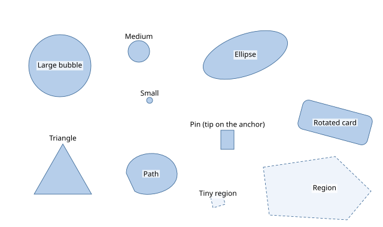

# Shapes

A label belongs next to its feature's *outline*, not next to a bounding box around it.
Every item has a **mark**, the true geometry of the labeled feature: adjacent labels touch
it (at `placement.offset`, 1 px), other labels keep a margin from it, and a mark large
enough holds its label inside.

```json
--8<-- "examples/tutorials/problems/shapes.json"
```



## Mark shapes

`anchor.mark` (default: a circle of radius 2) is one of:

| shape | geometry | the anchor `(x, y)` is |
|---|---|---|
| `circle` | `r` | the center |
| `ellipse` | `rx`, `ry`, `rotation` (degrees, clockwise on screen) | the center |
| `rect` | `w`, `h`, `corner_radius`, `rotation` | the center |
| `polygon` | `points` (+ `holes`), absolute coordinates or px offsets with `relative: true` | the anchor as given |
| `path` | SVG path data `d`, flattened to polygons (0.25 px), absolute or `relative` | the anchor as given |
| `icon` | a `w` × `h` box whose `tip` (default bottom center `[w/2, h]`) sits on the anchor; optional `silhouette` | the tip |
| `from_svg` | the outline of an SVG element (`svg_id` or `selector`) | the anchor as given |

Sizes and offsets are in pixels and never transformed by `transform`; absolute polygon and
path coordinates are.

**Touching the true shape.** The eight adjacent positions put the label's corner (diagonal
positions) or side midpoint (top, right, bottom, left) onto the outermost point of the mark
in that direction: for a circle, the top-right label touches the circle at 45°, not the
corner of its bounding box. Concave shapes use their convex hull for this, and their true
outline for every overlap test. Sliding positions move the label along the mark between
two fixed positions.

## Internal labels

`placement.internal` decides whether labels may go inside their mark:

* `auto` (default) — *prefer* inside for rectangles, ellipses, polygons, paths and areas;
  *allow* it for circles with `r ≥ internal_circle_ratio` (1.5) × the label height;
  never for icons;
* `prefer` — inside first, outside only when inside does not fit;
* `allow` — inside after every outside position;
* `never`.

An internal label must fit inside the mark with `inner_padding` (0.2 em) to spare; its
candidates are the pole of inaccessibility (the point farthest from the outline) and the
reference point. In the example, the large circle's item sets
`"placement": {"internal": "prefer"}`; otherwise an inside label would only be *allowed*,
after the outside positions. The ellipse, the card and the path take their labels inside;
the triangle is too narrow at its pole and gets an outside label.

Per item, `placement` overrides `models`, `offset`, `internal` and `position_order`.

## Icons with a tip

A map pin's point is at its bottom: with `tip: [11, 32]` the icon's box hangs above the
anchor, labels avoid the whole box, and leaders start at the tip.

## Area anchors

An item with an `area` anchor labels a region: its label goes inside the polygon if it
fits, at the pole of inaccessibility or another interior point, ordered by clearance. If it
does not fit ("Tiny region"), the item becomes a point at the pole with a small dot mark
(`anchor.dot`, by default a circle of radius 2) and gets an outside label, on a leader if
needed. Areas are not obstacles for other labels.

## Covering one's own mark

By default a label never covers its own mark (`avoid.label.own_mark: "hard"`).
`"partial:0.3"` lets external labels cover up to 30 % of it, `"ignore"` any part — useful
for tiny marks under long labels.

## In Python

```python
--8<-- "examples/tutorials/python/shapes.py:shapes"
```

`output.item_shape` (`item_shape=True`) reports each item's resolved geometry in canvas
pixels, e.g. to draw the marks exactly where the engine saw them:

```python
--8<-- "examples/tutorials/python/shapes.py:item-shape"
```

## Shapes without labels

Unlabeled shapes go into `obstacles.vector` layers, one class per layer: `points` with a
radius `r`, `circles` (`[x, y, r]`), `rects` (`[x, y, w, h]`), `polygons`, `polylines`
with a stroke `width`, and `shapes`, any mark with a position (`{"shape": "ellipse",
"x": …, "y": …, "rx": …, "ry": …}`); see [the problem format](../concepts/problem.md#obstacles).

Labels have shapes too: besides text, a label can be an `icon` or `box` of fixed size
(`shape`: `rect`, `rounded:r`, `circle` or a `polygon` silhouette) or a `composite` of
text, icon and box parts in a row or column ([labels](../concepts/problem.md#labels)).
