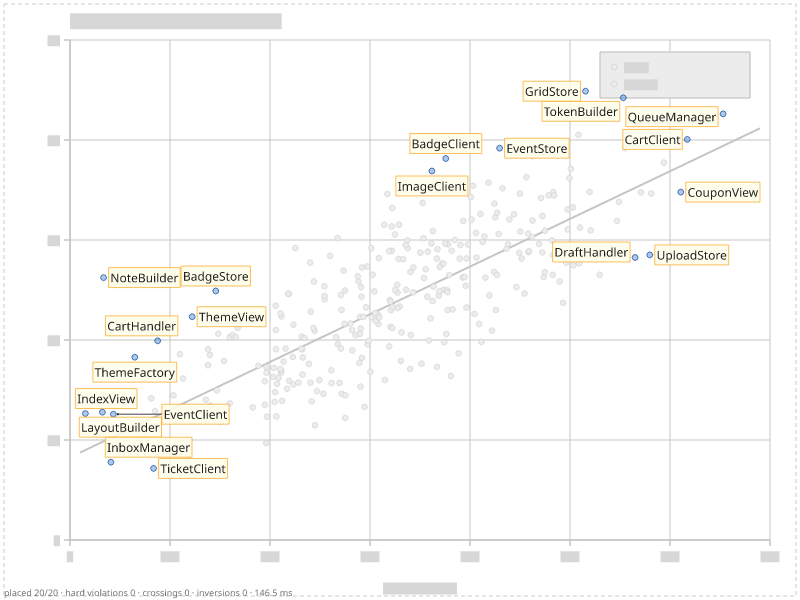

# Labels over an SVG background

An SVG background is more than pixels: every drawn element is geometry with a name, a
class and an id. Label Anything parses the SVG, turns every drawn element into obstacle
geometry (fills as polygons, strokes as capsules, text as boxes) and sorts it into
**obstacle classes** with CSS selectors. Each class then gets its own weight for labels
and for leaders — points may be covered a little, the trend line less, text and the
legend never.

The chart of the [outliers tutorial](outliers.md), this time as `scatter.svg`:

```xml
--8<-- "examples/tutorials/data/scatter.svg:1:4"
    ...
--8<-- "examples/tutorials/data/scatter.svg:55:57"
    ...
--8<-- "examples/tutorials/data/scatter.svg:338:339"
    ...
--8<-- "examples/tutorials/data/scatter.svg:360:365"
```

## Class rules

`obstacles.svg.classes` is a list of `{selector, class}` rules; for every drawn element,
the **first matching rule** decides its class. Elements no rule matches get
`default_class` (`"ink"`); the class `"ignore"` drops them.

```json
--8<-- "examples/tutorials/problems/svg-classes.json:1:21"
  "items": [ ... ]
}
```

* `#background` would otherwise be one big obstacle covering everything. (The presets'
  rules use the pseudo-class `:background` — an element covering ≥ 90 % of the canvas — for
  the same purpose.)
* `.legend *` comes before `text`, so the legend's texts are `legend`, not `text`. The
  `<rect>` of the legend is matched too: labels avoid the whole legend box.
* `.grid line` is ignored by labels and leaders: grid lines may be crossed freely.
* `.axis line` is `axes`, which the `scatter` preset makes hard for labels.
* Tick labels, the title and the axis title are `text`, hard by default.
* `circle.point` matches every dot, including the outliers.

Selectors are a CSS subset: type, `.class`, `#id`, `[attr]`, `[attr=value]`, `*`,
descendant (space) and child (`>`) combinators, comma lists, and four pseudo-classes:
`:small` (bounding box ≤ 16 px in both directions), `:background`, `:filled` and
`:unfilled`. Anything else is a validation error (`pattern`). The full rules — viewports,
`<use>`, styles, what is not modelled (clipping, masks, filters, markers, dashes) — are in
[spec §4.5](../reference/spec.md#45-svg-backgrounds).

## Marks taken from the SVG

The outliers are drawn in the SVG too. `svg_id` names the element that draws an item and
`auto_mark_items: true` makes that element the item's **mark** — the shape its label
touches and other labels must not cover — and removes it from its obstacle class, so a
label does not pay for covering its own point. Without `auto_mark_items`, a mark can name
its element explicitly: `{"shape": "from_svg", "svg_id": "o3"}` or
`{"shape": "from_svg", "selector": "circle#o3"}`.

## The result



The debug rendering draws the SVG's geometry in grey: dots, lines, and the boxes of the
texts. All 20 labels avoid the title, the tick labels and the legend (hard), stay off the
trend line where they can (1.5) and pay little for covering dots (0.3).

## The same in Python

```python
--8<-- "examples/tutorials/python/svg_background.py:place"
```

`background=` takes a path, SVG markup as `str` or `bytes`, and `svg_classes=` accepts
`(selector, class)` pairs, `{selector: class}` dicts or the rule objects. The program checks
that this call builds the same problem as the JSON file: same boxes.

## Checking what the rules matched

A typo in a class name is easy to make and silent: the class just never occurs. Validation
reports a **warning** `unknown_class` for every class in `avoid` that no source produces:

```python
--8<-- "examples/tutorials/python/svg_background.py:warnings"
```

To see what each class covers, solve with `debug_svg=True` (CLI: `--debug-svg`): the
overlay has one heatmap layer per class (`heatmap-points`, `heatmap-text`, …), and
`stats.grid.classes` lists the classes that occur.

```python
--8<-- "examples/tutorials/python/svg_background.py:debug"
```

## Without class rules

Without `classes`, the preset's rules apply. The `auto` and `scatter` presets ignore
`:background`, make `text` hard, put circles, ellipses and small shapes into `points`,
paths and lines into `lines`, and everything else into `ink` — sensible for SVG exported
from matplotlib, ggplot2, Vega or Plotly. See [presets](../reference/presets.md).
