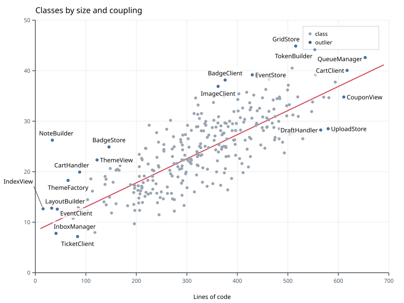

# Labels over an SVG background

An SVG background is more than pixels: each drawn element is geometry with a type, a
class and an id. Label Anything turns every drawn element into obstacle geometry (fills as
polygons, strokes as capsules, text as boxes) and sorts it into **obstacle classes** with
CSS selectors. Each class gets its own weight for labels and for leaders: points may be
covered a little, the trend line less, text and the legend never.

The chart of the [outliers tutorial](outliers.md), this time as `scatter.svg`:

```xml
--8<-- "examples/tutorials/data/scatter.svg:1:4"
    ...
--8<-- "examples/tutorials/data/scatter.svg:55:57"
    ...
--8<-- "examples/tutorials/data/scatter.svg:338:339"
    ...
--8<-- "examples/tutorials/data/scatter.svg:360:365"
```

## Class rules

`obstacles.svg.classes` is a list of `{selector, class}` rules; for every drawn element,
the **first matching rule** decides its class. Elements no rule matches get
`default_class` (`"ink"`); the class `"ignore"` drops them.

```json
--8<-- "examples/tutorials/problems/svg-classes.json:1:21"
  "items": [ ... ]
}
```

* `#background` would otherwise be one obstacle covering everything.
* `.legend *` comes before `text`, so the legend's texts are `legend`, not `text`. The
  `<rect>` of the legend is matched too: labels avoid the whole legend box.
* `.grid line` is ignored: labels and leaders may cross grid lines freely.
* `.axis line` is `axes`, which the `scatter` preset makes hard for labels.
* Tick labels, the title and the axis title are `text`, hard by default.
* `circle.point` matches every dot, including the outliers.

Selectors are a CSS subset: type, `.class`, `#id`, `[attr]`, `[attr=value]` and the
prefix, suffix and substring forms `[attr^=value]`, `[attr$=value]`, `[attr*=value]`, `*`,
descendant (space) and child (`>`) combinators, comma lists, and four pseudo-classes:
`:small` (bounding box ≤ 16 px in both directions), `:background` (covering ≥ 90 % of the
canvas), `:filled` and `:unfilled`. Anything else is a validation error (`pattern`). The
full rules — viewports, `<use>`, styles, what is not modelled (clipping, masks, filters,
markers, dashes) — are in [spec §4.5](../reference/spec.md#45-svg-backgrounds).

## Marks taken from the SVG

The outliers are drawn in the SVG too. `svg_id` names the element that draws an item.
With `auto_mark_items: true`, that element becomes the item's **mark** — the shape its
label touches and other labels avoid — and leaves its obstacle class, so a label pays
nothing for covering its own point. Without `auto_mark_items`, a mark names its element
itself: `{"shape": "from_svg", "svg_id": "o3"}` or
`{"shape": "from_svg", "selector": "circle#o3"}`.

## The result



The rendering shows the SVG's geometry in grey: dots, lines and the boxes of the texts.
All 20 labels are placed, clear of every text and the legend.

## In Python

```python
--8<-- "examples/tutorials/python/svg_background.py:place"
```

## Checking what the rules matched

A typo in a class name is easy to make and hard to notice: the class never occurs.
Validation therefore warns (`unknown_class`) about every class in `avoid` that no source
produces:

```python
--8<-- "examples/tutorials/python/svg_background.py:warnings"
```

To see what each class covers, solve with `debug_svg=True` (CLI: `--debug-svg`): the
overlay has one heatmap layer per class (`heatmap-points`, `heatmap-text`, …), and
`stats.grid.classes` lists the classes that occur.

```python
--8<-- "examples/tutorials/python/svg_background.py:debug"
```

## Without class rules

Without `classes`, the preset's rules apply. The `auto` and `scatter` presets ignore
`:background` and put text into `text` (hard by default), circles, ellipses and small
shapes into `points`, paths and lines into `lines`, and everything else into `ink` — rules
that suit SVG exported from matplotlib, ggplot2, Vega or Plotly
([presets](../reference/presets.md)).
